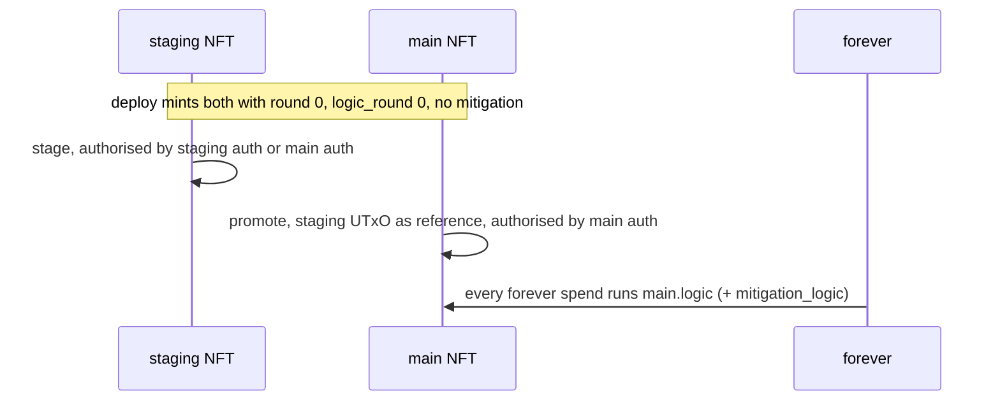

# Contracts architecture

The Aiken validators in `validators/` and `lib/` on bookmark `staking/contracts`, which carries the staking contracts and reserve v2 on `cli/effect4`. Each claim below cites the source line on that bookmark, or the command that shows it. The full per-validator constraints are in [docs/governance/validators.md](../governance/validators.md); where that file and the code disagree, the code wins.

## The component pattern

Every governed component is three validators. The forever and two-stage mints consume the same one-shot UTxO:
- **forever** holds the state NFT and datum. Any spend needs the logic named on the main upgrade state to run as a withdrawal.
- **two-stage upgrade** holds a `main` and a `staging` NFT, each with an `UpgradeState` datum.
- **logic** is a withdraw-zero script with the rules.

Sources: the shared one-shot (`reserve.ak:16-20`, `reserve.ak:36-40`); the forever spend (`lib/forever/script.ak:36-61`); promote and stage auth (`lib/upgradable/two-stage-upgrade.ak:184`, `:281-290`); the auth scripts (`lib/auth/script.ak:15-46`, `lib/auth/staging.ak:54-96`); the logic quorum (`lib/logic/script.ak:93-137`); the native-script check (`lib/multisig/script.ak:92-121`).

### Components

`<c>` is the component's prefix in `aiken.toml` config keys.

| Component | `<c>` | Validators (file) | Logic | Logic threshold key |
|---|---|---|---|---|
| Reserve | `reserve` | `reserve_forever`, `reserve_two_stage_upgrade`, `reserve_logic` (`reserve.ak:14,32,47`); `reserve_logic_v2` and the test-only `reserve_staging_params` (`reserve_v2.ak:12,36`); `reserve_staging_forever` (`staging_reserve_ics.ak:21`) | v1 merge (`reserve.ak:51`); v2 release (`reserve_v2.ak:22`, `lib/logic/reserve.ak:34`) | none |
| ICS | `ics` | `ics_forever`, `ics_two_stage_upgrade`, `ics_logic` (`illiquid_circulation_supply.ak:14,29,41`); `ics_logic_v2` (`illiquid_circulation_supply_v2.ak:7`); `ics_staging_forever` (`staging_reserve_ics.ak:43`) | merge (`illiquid_circulation_supply.ak:45`) | none |
| Council | `council` | `council_forever`, `council_two_stage_upgrade`, `council_logic` (`permissioned.ak:55,73,88`); `council_logic_v2` (`permissioned_v2.ak:86`); `council_staging_forever` (`staging_permissioned.ak:57`) | multisig (`permissioned.ak:92-99`) | `main_council_update_threshold_hash` (`permissioned.ak:98`) |
| Tech auth | `technical_authority` | `tech_auth_forever`, `tech_auth_two_stage_upgrade`, `tech_auth_logic` (`permissioned.ak:104,122,137`); `tech_auth_logic_v2` (`permissioned_v2.ak:110`); `tech_auth_staging_forever` (`staging_permissioned.ak:79`) | multisig (`permissioned.ak:141-148`) | `main_tech_auth_update_threshold_hash` (`permissioned.ak:147`) |
| Federated ops | `federated_operators` | `federated_ops_forever`, `federated_ops_two_stage_upgrade`, `federated_ops_logic` (`permissioned.ak:153,171,186`); `federated_ops_logic_v2` (`permissioned_v2.ak:134`); `federated_ops_staging_forever` (`staging_permissioned.ak:101`) | multisig (`permissioned.ak:190-197`) | `main_federated_ops_update_threshold_hash` (`permissioned.ak:196`) |
| Terms & conditions | `terms_and_conditions` | `terms_and_conditions_forever`, `_two_stage_upgrade`, `_logic` (`terms_and_conditions.ak:21,39,54`); `terms_and_conditions_logic_v2` (`terms_and_conditions_v2.ak:35`); `terms_and_conditions_staging_forever` (`staging_tandc.ak:23`) | multisig (`terms_and_conditions.ak:58-65`) | `terms_and_conditions_threshold_hash` (`terms_and_conditions.ak:64`) |
| cNIGHT minting | `cnight_minting` | `cnight_mint_forever`, `cnight_mint_two_stage_upgrade`, `cnight_mint_logic` (`cnight_minting.ak:49,56,71`); `cnight_mint_logic_v2` (`cnight_minting_v2.ak:4`) | v1 always passes (`cnight_minting.ak:72-74`); v2 always fails (`cnight_minting_v2.ak:5-7`) | none |
| Committee bridge | `committee_bridge` | `committee_bridge_forever`, `committee_bridge_two_stage_upgrade`, `committee_bridge_logic` (`committee_bridge.ak:12,38,53`) | BEEFY proof (`committee_bridge.ak:57-84`) | `beefy_signer_threshold_hash` (`committee_bridge.ak:75`) |

Two components differ from the pattern:
- `cnight_mint_forever` holds no state NFT. It is a withdraw script that requires the logic and mitigation logic named on the cNIGHT main upgrade state (`cnight_minting.ak:10-46`). A minting policy then depends on that withdrawal; `test_cnight_minting_proxy` shows the chain (`test_cnight_minting_proxy.ak:7-19`). The production cNIGHT policy lives in a separate repository.
- The committee bridge has no v2 logic and no staging forever, on `main` or on this line.

Governance-wide validators: `main_gov_auth` and `staging_gov_auth` (`gov_auth.ak:6,14`); `main_gov_threshold`, `staging_gov_threshold`, `main_council_update_threshold`, `main_tech_auth_update_threshold`, `main_federated_ops_update_threshold`, `beefy_signer_threshold` and `terms_and_conditions_threshold` (`thresholds.ak:36,125,140,155,181,196,211`).

Standalone validators, outside the pattern: `night_staking` (`night_staking.ak:45`) and `night_registration` (`night_registration.ak:27`), described [below](#the-staking-contracts-and-reserve-v2); `cnight_generates_dust` (`cnight_generates_dust.ak:41`), `always_fails` (`always_fails.ak:8`), the test-only `tcnight_mint_infinite` (`test_cnight_no_audit.ak:7`) and `test_cnight_minting_proxy`, and the type-export `z_*` validators that always fail (`validator_types.ak:22-114`, `validator_types_v2.ak:5-33`). `registered_candidate` is gone: night_registration replaces it (user decision, 11-17). The deployment records (`deployed-scripts/`, `plutus-preprod.deployed.json`, `release/`) still name it, and so do main's network builds (`plutus.json`, `plutus-<network>.json` and their `contract_blueprint_<network>.ts`) until the next build for that network.

### What each validator compiles in

Every hash and one-shot is a `config.*` constant, so it is part of the script hash.

| Role | Compiles in | Source |
|---|---|---|
| forever | `<c>_one_shot_hash`, `<c>_one_shot_index`, `<c>_two_stage_hash`, `cnight_policy` | `reserve.ak:16-25`; `lib/forever/script.ak:32` |
| two-stage upgrade | `<c>_one_shot_hash`, `<c>_one_shot_index`, `cnight_policy` | `reserve.ak:36-42`; `lib/upgradable/two-stage-upgrade.ak:453` |
| merge logic (reserve, ICS) | `<c>_forever_hash`, `cnight_policy`, `cnight_name` | `reserve.ak:51`; `lib/logic/script.ak:64-65` |
| multisig logic (council, TA, fed ops, T&C) | `<c>_forever_hash`, the component's threshold hash, `technical_authority_forever_hash`, `council_forever_hash` | `permissioned.ak:96-98`; `lib/logic/script.ak:112-131` |
| v2 state logic (the five `*_logic_v2` of ICS, council, TA, fed ops, T&C) | `<c>_logic_v2_one_shot_hash`, `<c>_logic_v2_one_shot_index`, `<c>_forever_hash`, `<c>_two_stage_hash`, `cnight_policy`; multisig v2 also the threshold, TA and council forever hashes; merge v2 also `cnight_name` | `illiquid_circulation_supply_v2.ak:10-21`; `permissioned_v2.ak:89-105`; `lib/logic/next_version.ak:74,83,102,167-184,216` |
| `reserve_logic_v2` | `reserve_logic_v2_init_one_shot_hash` and `_index`, `reserve_two_stage_hash`, `reserve_forever_hash`, `ics_forever_hash` and `reserve_staging_params_hash`, passed by the validator; `cnight_policy`, `cnight_name` and the `release_*` constants, read by the library | `reserve_v2.ak:18-19,26-29`; `lib/logic/reserve.ak:25,27,98,237-238,310-311,323,327-328,334,340,347` |
| `reserve_staging_params` | `reserve_staging_params_one_shot_hash` and `_index`, `staging_gov_auth_hash`, `cnight_policy` (main's marker, so the hash differs per network) | `reserve_v2.ak:46-47,65,71` |
| `night_staking` | `cnight_policy`, `cnight_name`, `lock_deposit_lovelace`, `unbonding_delay_ms`, `night_registration_hash` | `night_staking.ak:254,276-277,328,378-379,398-399` |
| `night_registration` | `night_registration_one_shot_hash`, `night_registration_one_shot_index`, `cnight_policy` (the marker), `node_datum_max` (`NODE_DATUM_MAX`, 4,500) | `night_registration.ak:91-92,152,435` |
| `cnight_mint_logic_v2` | nothing; it always fails | `cnight_minting_v2.ak:1-8` |
| staging forever | `<c>_staging_one_shot_hash`, `<c>_staging_one_shot_index`, `<c>_two_stage_hash`, `cnight_policy` | `staging_reserve_ics.ak:23-33`; `lib/forever/staging.ak:30` |
| `main_gov_auth` | `main_gov_threshold_hash`, `technical_authority_forever_hash`, `council_forever_hash`, `cnight_policy` | `lib/auth/script.ak:20,34,41,57` |
| `staging_gov_auth` | `council_two_stage_hash`, `main_gov_threshold_hash`, `staging_gov_threshold_hash`, `technical_authority_forever_hash`, `council_forever_hash`, `cnight_policy` | `lib/auth/staging.ak:59,64,69,84,91,110` |
| `main_gov_threshold` | `main_gov_one_shot_hash`, `main_gov_one_shot_index`, `technical_authority_forever_hash`, `council_forever_hash` | `thresholds.ak:43-47,90,97` |
| other thresholds | their own one-shot pair (`staging_gov_`, `main_council_update_`, `main_tech_auth_update_`, `main_federated_ops_update_`, `committee_threshold_`, `terms_and_conditions_threshold_`), plus `cnight_policy`, `main_gov_threshold_hash`, `technical_authority_forever_hash`, `council_forever_hash` | `thresholds.ak:129-218`; `lib/multisig/script.ak:141,159,174,181` |
| `cnight_mint_forever` | `cnight_minting_two_stage_hash`, `cnight_policy` | `cnight_minting.ak:42,51` |
| `committee_bridge_logic` | `committee_bridge_forever_hash`, `beefy_signer_threshold_hash` | `committee_bridge.ak:64,75` |

## What each role enforces

A summary; the constraint lists are in [validators.md](../governance/validators.md).

- **forever**:
  - Mint: consume the one-shot, mint exactly one empty-named token, send it to the script's own address with an inline datum, and pass the component's initial-state check (`lib/forever/script.ak:23-34`, `lib/utils.ak:82-108`).
  - Spend: the two-stage `main` NFT must be a reference input, and its datum's `logic` and (when set) `mitigation_logic` must run as withdrawals (`lib/forever/script.ak:36-61`, `lib/upgradable/two-stage-upgrade.ak:345-371`). The forever checks nothing about the outputs; the logic does.
- **two-stage upgrade**: mints the `main` and `staging` NFTs once, then validates stage and promote spends (see the lifecycle below; `lib/upgradable/two-stage-upgrade.ak:35-161`).
- **merge logic** (reserve, ICS): every input at the forever address joins one output at that exact address (no stake credential). The output holds only ADA and `cnight_policy`/`cnight_name`, at least the summed amounts, and no datum hash. The forever NFT may not be spent (`lib/logic/script.ak:17-78`). No signatures are needed. See [Reserve](../governance/validators.md#reserve-validators) and [ICS](../governance/validators.md#illiquid-circulation-supply-validators).
- **multisig logic** (council, TA, fed ops, T&C):
  - Reads the fractions from the threshold NFT in the reference inputs.
  - Requires tech-auth and council approval.
  - Validates the new forever datum with the component's structure check (`lib/logic/script.ak:83-147`; `permissioned.ak:15-52`; `terms_and_conditions.ak:12-18`).
  - Approval means the transaction mints under the N-of-M native script rebuilt from the body's `Versioned<Multisig>` datum, needing `ceil(total × numerator / denominator)` signers (`lib/multisig/script.ak:29-63`, `:92-121`). The ledger, not Plutus, checks the signatures.
- **gov auth**: `main_gov_auth` requires the same two approvals at `main_gov_threshold` (`lib/auth/script.ak:12-61`). `staging_gov_auth` uses `main_gov_threshold` when its own hash is the `auth` on the council's main upgrade state, else `staging_gov_threshold` (`lib/auth/staging.ak:15-71`). See [Governance Auth](../governance/validators.md#governance-auth-validators).
- **thresholds**:
  - Mint once, with `0 ≤ numerator < denominator` for both fractions (`thresholds.ak:16-30`, `lib/multisig/script.ak:134-144`).
  - Spend: needs TA and council approval at `main_gov_threshold`'s fractions. `main_gov_threshold` itself uses the fractions in its own datum. The NFT stays at its address with a valid datum (`lib/multisig/script.ak:146-199`; `thresholds.ak:57-117`).
  - `beefy_signer_threshold` validates a `BeefyThreshold` instead (`thresholds.ak:171-178`, `:206`).
  - See [Governance Thresholds](../governance/validators.md#governance-threshold-validators).
- **committee bridge logic**: verifies a BEEFY consensus proof against the input state, the output state and the `BeefyThreshold` reference input (`committee_bridge.ak:53-86`). See [Committee Bridge](../governance/validators.md#beefy-backed-committee-bridge-validators).

## The staking contracts and reserve v2

Each transaction these four contracts take part in is drawn, with its rules, in [docs/transactions/README.md](../transactions/README.md).

### night_staking

- **Role.** Holds delegation locks, the cNIGHT a holder stakes behind one pool (staking MIP, PR 421, rules 1 to 8). One script is the token's policy, the locks' address and a stake credential (`night_staking.ak:42-44`).
- **Shape.** One `else(ctx)` with `when info is`, as main's validators (`night_staking.ak:45-298`):
  - `Minting` and `Spending` only require the script's own withdrawal (rule 6, `:61-75`).
  - `Withdrawing` reads the redeemer `StakingAction` (`:35-40`): `Lock`, `Update`, `Unbond` or `Unlock`, each with one transaction shape (MIP 421 rule 7), and runs every other rule once per transaction (`:77-289`).
  - `Publishing` accepts a stake credential registration; everything else fails, so no vote or proposal passes (rule 8, `:291-295`).
- **Where each rule lives**, in `Withdrawing` and its three helpers:
  - Rule 7: one `foldr` over the inputs finds at most one input at the address (`:82-96`); each action expects none (`Lock`) or one, places the lock first among the outputs, and refuses any other output at the address or carrying the token with `no_script_output` (`lib/staking/script.ak:22-36`).
  - Lock (`:100-129`): rule 1 (`:111-112`), rule 2 (the helper `lock_output` at `:300-338`), and rule 2's reference input of the pool's node (`:125-126`, the helper `pool_registered` at `:389-418`, which finds the node with `must_find` and `is_singleton`).
  - A lock's value is matched whole, ADA, the token and cNIGHT and nothing else, by `to_dict |> to_pairs` in the helper `lock_value` (`:340-387`), for the spent lock and every new one.
  - Update (`:131-175`): rule 3; the pool's node is read only when `pool_id` changes (`:167-171`); `return_address` changes only under the input return address's payment credential (`:159-166`).
  - Unbond (`:177-225`): rule 3, `unbond_at` set to exactly the validity upper bound (`:211`), the datum rebuilt field by field.
  - Unlock (`:227-284`): rule 4, the burn and the delay (`:245-260`), and the payout as the first output, exactly ADA and cNIGHT (`:262-281`); a lock without cNIGHT unlocks at once, whatever its `unbond_at`.
  - Rule 5, the owner authorizes every action through `check_auth` (`:287-288`, `lib/staking/script.ak:8-20`).
- **The types** are the datum `DelegationLock`, with `return_address` between `reward_address` and `unbond_at` as #421 orders it (`night_staking.ak:17-31`), and the redeemer `StakingAction`; `z_night_staking_types` puts both in the blueprint (`validator_types_v2.ak:15-23`).

### night_registration

- **Role.** Holds the registration set: the nodes of two sorted linked lists, by `crch` over every node and by `pool_id` over the active pools (rules 9 and 10). Each link names the node before; the first node of a list links to `#""`, and the `Tail` is the last node of both lists (MIP 421 ab25a20d). One script is the nodes' address, the token's policy and a stake credential; its one parameter is the initialization UTxO (`night_registration.ak:24-26`, `:89-93`).
- **Shape.** One `else(ctx)` with `when info is` (`night_registration.ak:27-418`), the withdrawal pattern (MIP 421 rule 10; user decision, 11-17: "withdraw checks everything"):
  - `Minting` and `Spending` only require the script's own withdrawal (`:42-56`), as night_staking's rule 6 and main's `cnight_generates_dust.ak:101-155`.
  - `Withdrawing` reads the redeemer `RegistrationAction` (`lib/registration/types.ak:26-35`): `Init`, `CreateTwoAnchors` (diagram 7a), `CreateOneAnchor` (diagram 7b), `Update` or `Deactivate`, each with one transaction shape, and runs every rule once per transaction (`:58-410`). It finds the spent nodes with one `foldr2` over the inputs, which also refuses an input with the script's payment credential, whatever its stake part, that is not a node (`:63-85`), then checks `Init` (`:88-158`), `Update` (`:160-220`), `Deactivate` (`:222-283`) or the two Creates, which share the new node's checks and differ in the anchors (`:285-408`).
  - `Publishing` accepts the registration of the credential; everything else fails (`:412-416`). The deploy registers the credential before the initialization (diagram 0).
  - `Init` carries main's `own_hash != config.cnight_policy` marker (`:151-152`), one per script as in main.
- **Where each rule lives.**
  - Rule 9, node shape, in the helper `node_output`, used for every node output, anchors included (`night_registration.ak:420-462`): a node's value is `is_singleton`, ADA and the token and nothing else, for spent nodes too (`:76`); its datum, with both links set to `#""` by the helper `unlinked` (`:613-619`), is at most `NODE_DATUM_MAX` when `serialise_data` encodes it (`:432-436`); an active node's `pool_id` and owner hash are 28 bytes, `reward_address` 32, and `fixed_cost` from 0 to 2^128 − 1. No length is checked on `crch` or `crch_signature`.
  - Rule 9, the crch order: one helper, `crch_less` (`:482-494`), compares the lengths first and, for equal lengths, the bytes with `builtin.less_than_bytearray`, so `#""` is the smallest key (user decision, 11-18). Every comparison in the crch list goes through it: Init (`:125`) and Create (`:311-312`, with `crch_below` at `:515-521`). The pool list compares `pool_id` with `builtin.less_than_bytearray` (`:313-314`, `pool_below` at `:532-539`).
  - Rule 9, sorted lists: Init, in one `foldr2` over the outputs that places the Reserved nodes first, in crch order, and the Tail last (`:101-142`); Create, where each new key sorts above its anchor's old link and below its anchor's key and the new node takes the old links (`:305-318`); Deactivate, whose anchor's `prev_pool` is the node's `pool_id` (`:252-253`); and the pool-list membership in `pool_link` (`:523-530`).
  - Rule 10, Create: one mint (`:344-345`), output order and relinked anchors, one anchor for `CreateOneAnchor` and two for `CreateTwoAnchors` (`:346-404`), cold key (`:405-406`) and delegation certificate (`:320-341`).
  - Rule 10, Update (`:190-219`) and Deactivate (`:255-282`); outputs after the nodes go through `no_script_output` (`lib/staking/script.ak:22-36`). A spent node never comes back with less ADA, except the node a Deactivate empties.
- **The types** are the datum `Node` (`Tail`, `Reserved`, `Registration`, with `prev_crch` and `prev_pool` links) and the redeemer `RegistrationAction` (`lib/registration/types.ak:3-35`); `z_night_registration_types` puts both in the blueprint (`validator_types_v2.ak:25-33`).

### reserve_logic_v2

- **Role.** The reserve's v2 logic: PR 406's Cardano Reserve Release. It is a logic upgrade, so its code sits under `lib/logic`; it does not use `lib/logic/next_version.ak` but calls `reserve_release` in `lib/logic/reserve.ak`, which takes the contract hashes and the init seed as arguments, as `logic_merge` does (`reserve_v2.ak:11-33`).
- **Purposes**: mint, withdraw and publish only; there is no spend purpose and no UTxO at its address (`lib/logic/reserve.ak:32-33`, `:411`). The redeemer decides the action, and each action accepts one transaction shape (user decision, 11-17).
  - `mint`, redeemer `InitTokenAction`: `MintInitTokens` mints the two init tokens `"main"` and `"staging"` from their seed UTxO (`:67-75`); `BurnInitToken` is the Init burn, which needs the withdrawal with redeemer `Init` (`:78-83`). It mints no staging params token.
  - `withdraw`, redeemer `ReserveAction`: Init (`:214-262`), Release (`:264-359`, PR 406 rules 1 to 8), Pause and Unpause (`:361-403`). One fold over the inputs, as `logic_merge` does, finds the state input by the exact forever-NFT shape, takes at most one other input at the forever address (the reserve NIGHT), and in Release refuses any input at the destination (`:121-154`). The state output is found by position: outputs[2] in Release, outputs[0] otherwise; one fold over the later outputs refuses any at the forever address and, in Release, any at the destination (`:162-205`). The ICS rule is Release's only: the node does not observe Init, Pause or Unpause (user decision, 11-17). Init finds its NIGHT reference with `must_find`, address first, then the exact value (`:219-247`).
  - Release checks its first three outputs by position: the ICS output, the reserve NIGHT output, the state output (diagram 13; `:279`, `:337-341`). Rule 1 is a literal in the state's `expect` pattern (`:269-275`).
  - Pause and Unpause need the reserve two-stage main state's `auth`, and its `mitigation_auth` once that is set, through main's `validate_running` (user decision, 11-17; `:375-393`). After the freeze, `mitigation_auth` is always_fails, so they can no longer run: once tested, the reserve logic is independent of governance.
  - Init does not read the state input's datum; it writes `initial_state()` whatever was there. It runs once per track because its init token is minted once and Init burns it. The other init token stays in the deployer's change, unchecked. Release, Pause and Unpause refuse a state that does not parse as `ReserveRewardState`, such as the deploy datum.
  - `publish`: registration only (`:408-409`).
- **Main or staging.** `logic_is_on_main` decides the track. On main the logic uses the compiled forever, NIGHT policy and ICS hashes; on the staging track it reads them from the reference input that holds `reserve_staging_params`'s NFT, whose policy it is given (`lib/logic/reserve.ak:90-110`).
- **The types** are `ReserveRewardState`, `ReserveAction`, `InitTokenAction` and `ReserveStagingParams`, in `lib/logic/types_v2.ak` next to `LogicRedeemer` (`lib/logic/types_v2.ak:12-47`), each with a `z_*` stub in `validators/validator_types_v2.ak` so the blueprint carries its schema.

### reserve_staging_params

- **Role.** A test-only contract that holds the staging track's `ReserveStagingParams`: the test NIGHT policy, the staging forever script and the destination (diagrams 11 and 11b; `reserve_v2.ak:35-36`, `lib/logic/types_v2.ak:41-47`).
- **Minting.** It mints its own NFT with the forevers' one-shot pattern, `input_linked_mint`: one token with the empty name, only when the transaction spends its seed UTxO, sent alone with ADA to outputs[0] at its own address with no stake part and an inline `ReserveStagingParams` of three 28-byte hashes (`reserve_v2.ak:43-67`).
- **Purposes.** Mint as above; a spend passes only with a `staging_gov_auth` withdrawal; every other purpose fails (`reserve_v2.ak:69-73`). The build pins its hash (see the build table below).

## The upgrade lifecycle

`UpgradeState` is `{logic, mitigation_logic, auth, mitigation_auth, round, logic_round}` (`lib/upgradable/types.ak:4-12`). The two-stage redeemer names the field (`Logic | Auth | MitigationLogic | MitigationAuth`) and the stage: `Main(staging_ref)` to promote, or `Staging(main_ref, new_hash)` to stage (`lib/upgradable/types.ak:14-30`).

- **Deploy.** One mint of exactly `main` and `staging` under the two-stage policy consumes the one-shot. `outputs[0]` is `main` and `outputs[1]` is `staging`, both at the script address, both `UpgradeState{logic, "", auth, "", 0, 0}` with 28-byte `logic` and `auth` (`lib/upgradable/two-stage-upgrade.ak:374-455`).
- **Stage** (`Staging`): spends the staging NFT with the main UTxO as a reference input at the same address (`:106-130`).
  - The new hash must be 28 bytes (`:259`).
  - Authorised when the staging datum's `auth` (and `mitigation_auth`) run, or the main datum's do, the recovery path when staging is stuck (`:281-290`).
  - Staging `Logic` increments `logic_round` (`:293-301`); `Auth`, `MitigationLogic` and `MitigationAuth` increment `round` (`:303-339`).
- **Promote** (`Main`): spends the main NFT with the staging UTxO as a reference input at the same address (`:70-104`).
  - Always needs the main datum's `auth` and `mitigation_auth` (`:184`).
  - `Logic` copies `logic` and `logic_round` from staging; `Auth` copies `auth` and `round` (`:186-212`).
- **Both spends**: the output at the script address keeps the NFT and carries exactly the expected datum (`:142-156`).
- **Mitigation.** `mitigation_logic` and `mitigation_auth` can be set once each: staging and promoting them requires main's to be empty (`:313-339`, `:214-246`). Once set, `mitigation_logic` must run in every forever spend (`lib/forever/script.ak:60`), and `mitigation_auth` beside `auth` in every promote and every stage (`:184`, `:282-290`, `validate_running` at `:345-371`). The one exception: staging `MitigationAuth` under the staging auth ignores the staging datum's `mitigation_auth` (`:283-287`).
- **`round` vs `logic_round`.** The upgrade state counts staged logic changes in `logic_round` and the other changes in `round`. The forever datum has its own `logic_round` (`Versioned`, `lib/forever/types.ak:1-5`; `FederatedOps`, `:35-40`), and some logic structure checks pin it:
  - v1 council and TA pin 0 (`permissioned.ak:16`); v1 T&C pins 0 (`terms_and_conditions.ak:13`).
  - v2 council and TA pin 1 (`permissioned_v2.ak:15`); v2 T&C pins 1 (`terms_and_conditions_v2.ak:11`); v2 federated ops pins 2 (`permissioned_v2.ak:48`).
  - v1 federated ops only checks that the datum decodes as `FederatedOps` (`permissioned.ak:48-52`), and the reserve and ICS merge logic has no structure check (`lib/logic/script.ak:17-78`).

  No validator ties the two counters together.

### The v2 logic path

Five v2 state logics call `lib/logic/next_version.ak`: `logic_merge_v2` for ICS (`illiquid_circulation_supply_v2.ak:15`), `logic_multisig_validation_nft_input_v2` for council, TA, fed ops and T&C (`permissioned_v2.ak:95`, `terms_and_conditions_v2.ak:6`). The other two do not: `cnight_mint_logic_v2` always fails and calls nothing (`cnight_minting_v2.ak:1-8`), and `reserve_logic_v2` calls `lib/logic/reserve.ak` ([above](#reserve_logic_v2)). This section describes the five.
- **One-shot state.** Each of the five is also a minting policy. Its one-shot mint creates a `StagingState{cnight_test_policy, forever_script_hash}` NFT (`next_version.ak:95-106`, `:209-220`; `lib/logic/types.ak:3-7`).
- **Main or staging.** On a withdrawal it checks whether it is the `logic` on its component's main upgrade state, from the reference inputs (`logic_is_on_main`, `lib/upgradable/two-stage-upgrade.ak:459-489`; called at `next_version.ak:82,138,195`). If it is, it acts on the main forever. If not, it reads `StagingState` and acts on the forever and cNIGHT policy named there (`next_version.ak:84-91`, `:143-153`).
- **Redeemer.** The multisig v2 redeemer is `LogicRedeemer` (`lib/logic/types_v2.ak:7-10`):
  - `Normal(inner)` runs the v1 quorum and structure checks with `inner` (`next_version.ak:134-190`, `:225`).
  - `Migrate` checks only that the forever datum moves from the v1 shape to the v2 shape, data unchanged (`next_version.ak:192-206`, `:226`). The migrations: `permissioned_v2.ak:55-62` (multisig, round 0 → 1), `:66-83` (`FederatedOps` → `FederatedOpsV2`) and `terms_and_conditions_v2.ak:20-32`. `Migrate` has no quorum check.
- **Unregistering** a multisig v2 logic's stake credential requires the same transaction to withdraw from that credential with a redeemer other than `Migrate`. Without such a withdrawal the `expect` fails (`next_version.ak:230-240`). The merge v2 logic runs its full validation on unregistering (`next_version.ak:108-112`).

### The staging track

The `staging_*` validators are forever validators that read the **staging** NFT where the normal forever reads `main` (`lib/forever/staging.ak:37-44` vs `lib/forever/script.ak:39-46`). Everything else is the same. Each has its own one-shot and compiles in the component's two-stage hash (`staging_reserve_ics.ak:21-58`, `staging_permissioned.ak:57-116`, `staging_tandc.ak:23-38`). A staging-forever UTxO is therefore spendable by whatever logic is staged. A staged v2 logic can then act on test state on the same network before promote, which is what `StagingState.forever_script_hash` points it at (`next_version.ak:84-91`). For the five logics on `next_version.ak`, the structural issues below block this path today.

The reserve's staging track works. `reserve_logic_v2` reads its test hashes from the reference input that holds `reserve_staging_params`'s NFT and never spends it (`lib/logic/reserve.ak:92-110`), so the staged logic acts on `reserve_staging_forever`'s NFT (diagrams 11 and 12b). The emulator tests run both tracks: the main track deploys, inits, releases, pauses and unpauses, then freezes the reserve two-stage (diagrams 18 and 19), after which Release still runs and the ledger refuses Pause and Unpause (`tests/reserve_v2.test.ts:200-201`); the staging track mints the staging params NFT, inits and releases with test NIGHT (`tests/reserve_v2.test.ts:699-700`).

## The audit map

- **Audit status:** nothing v2 was audited.
- **Edit policy** (AGENTS.md, "Mainnet Aiken Files"):
  - Files that existed at commit `ca38d87` and compile into a script deployed on mainnet are immutable; AGENTS.md lists them. `lib/auth/staging.ak` is the one exception and may be edited. `validators/registered_candidate.ak` was deleted on the user's explicit go (11-17): night_registration replaces it.
  - Files from `ca38d87` that never ran on mainnet may be edited (user decision, 11-19): `validators/committee_bridge.ak`, `lib/bridge/*.ak`, `lib/logic/next_version.ak`, `validators/test_cnight_no_audit.ak` and the `*.test.ak` files. None of them is in the audit's file list (`docs/audits/2026-01-08-txpipe-upgradable-contracts.pdf`, section 2), which names 17 files, all on mainnet.
  - `validators/validator_types.ak` may be updated in place too (user decision, 11-19): its `z_*` validators always fail and only export types to the blueprint for off-chain code. `lib/logic/types.ak` stays immutable; its new types go in `lib/logic/types_v2.ak`.
  - The `_v2` suffix marks a new version of an immutable original with the same name (e.g. `validators/reserve_v2.ak` next to `validators/reserve.ak`); new modules get plain names (e.g. `lib/logic/reserve.ak`). New types for the immutable logic go in `lib/logic/types_v2.ak`.
  - New helpers next to the audited `lib/utils.ak` go in `lib/utils_v2.ak`. The staking contracts and reserve v2 take only types, constructors and the `to_dict |> to_pairs` exact-value pattern from the stdlib; their other list work goes through `lib/utils.ak`, `lib/utils_v2.ak` and builtins (user decision, 11-18).
  - The post-audit staging files, `validators/staging_*.ak` and `lib/forever/staging.ak`, are freely editable.

Editing any validator changes its script hash. Deployed hashes live in `deployed-scripts/<env>/plutus.json`, and `build --from-deployed` builds against them (`cli/contracts/build.ts:610-687`).

## Config and hash pinning

- **Profiles.** `aiken.toml` has one `[config.<env>]` profile per network: `default`, `preview`, `qanet`, `govnet`, `devnet`, `preprod`, `mainnet`, `local` (`aiken.toml:18,303,587,871,1155,1439,1724,2010`).
- **Build.** `just build <env>` runs `vpx cli/main.ts build -n <env>` (`Justfile:6-7`). That runs `aiken build -S --env <env>` (`cli/contracts/build.ts:462-491`), so every `config.*` read becomes a compile-time constant of that profile.
- **Hash touches.** Validators that would otherwise not depend on `cnight_policy` still compare it against something, so that it feeds the script hash (e.g. `lib/forever/script.ak:31-32`, `lib/upgradable/two-stage-upgrade.ak:452-453`).
- **Hand-set values.** One-shot hashes and indices are set by hand per profile, e.g. the `*_one_shot_index` keys at `aiken.toml:27-67` and the `*_one_shot_hash` sections after them, for `default`.

The standard build (`buildStandard`, `cli/contracts/build.ts:539-612`) compiles the whole project eight or more times and writes hashes back into the profile between compiles:

```mermaid
flowchart LR
  c0["compile"] --> p0["cnight_policy := tcnight_mint_infinite hash (not mainnet)"]
  p0 --> c1["compile"] --> p1["two-stage hashes (6 core + cnight_minting)"]
  p1 --> c2["compile"] --> p2["forever hashes (6 core + cnight_minting) + night_registration"]
  p2 --> c3["compile"] --> p3["threshold hashes (6)"]
  p3 --> c3b["compile"] --> p3b["threshold hashes again (6)"]
  p3b --> c4["compile"] --> p4["staging_gov_auth"]
  p4 --> c5["compile"] --> p5["reserve_staging_params"]
  p5 --> c6["final compile"] --> p6["refresh all five groups"]
  p6 --> v["verify embedded dependency hashes; rebuild once if stale"]
```

| Step | Writes | Source |
|---|---|---|
| initial compile | `cnight_policy` := `tcnight_mint_infinite`'s hash; skipped on mainnet | `cli/contracts/build.ts:543-561`, `:275-299` |
| phase 1 | `<c>_two_stage_hash` for the six core components and cNIGHT minting | `cli/contracts/build.ts:563-567`, `:64-93` |
| phase 2 | `<c>_forever_hash`, same set, and `night_registration_hash`, which `night_staking` compiles in | `cli/contracts/build.ts:569-573`, `:95-127` |
| phase 3 | the six `*_threshold_hash` keys except BEEFY, compiled and written twice: the other five compile in `main_gov_threshold_hash`, which the first pass may move | `cli/contracts/build.ts:575-584`, `:129-154` |
| phase 4 | `staging_gov_auth_hash`, which `reserve_staging_params` compiles in | `cli/contracts/build.ts:586-588`, `:156-160` |
| phase 5 | `reserve_staging_params_hash`, which `reserve_logic_v2` compiles in | `cli/contracts/build.ts:590-592`, `:162-166` |
| final | recompiles and refreshes all five groups | `cli/contracts/build.ts:594-600`, `:493-532` |
| verify | the bytecode of `council_logic`, `tech_auth_logic`, `federated_ops_logic`, `main_gov_auth`, `night_staking`, `reserve_staging_params` and `reserve_logic_v2` must contain its dependency's hash; one rebuild, then fail | `cli/contracts/build.ts:493-532`, `:168-198`, `:403-431` |

The order follows the compile-time dependencies:
- **two-stage** depends only on its one-shot and `cnight_policy`.
- **forever** depends on the two-stage hash (`reserve.ak:25`).
- **thresholds** depend on the TA and council forever hashes (`thresholds.ak:90,97`), and all but `main_gov_threshold` on `main_gov_threshold_hash` (`lib/multisig/script.ak:159`).
- **logic and auth** depend on forever and threshold hashes (`permissioned.ak:96-98`, `lib/auth/script.ak:20`).
- **`reserve_logic_v2`** depends on `reserve_staging_params`, which depends on `staging_gov_auth` (`reserve_v2.ak:29,71`).

The would-be cycle between forever and logic is broken at run time: the forever reads the logic hash from the main upgrade datum instead of compiling it in (`lib/forever/script.ak:40-60`).

Not pinned by the engine:
- the committee bridge's `committee_bridge_two_stage_hash`, `committee_bridge_forever_hash` and `beefy_signer_threshold_hash`, and `bridge_signer_threshold_hash` (absent from the mappings, `cli/contracts/build.ts:64-166`);
- every v2 state-logic, staging and `night_registration` one-shot (hand-set per profile).

The verify step does not cover `terms_and_conditions_logic` or the five v2 logics on `next_version.ak` (`cli/contracts/build.ts:168-198`). `build --from-deployed` pins the core two-stage, forever and threshold hashes from `deployed-scripts/<env>/plutus.json` in `aiken.toml`, with `night_registration_hash` among the forever ones, runs the phased build with them (a pinned key keeps its pin; `--components` compiles the named components from new; a pinned validator that compiles to another hash fails the build), and restores `aiken.toml` (`cli/contracts/build.ts:614-691`, `:361-401`).

## Known structural issues

1. **The v2 staging NFT is a dead end.**
   - A v2 state logic mints its `StagingState` NFT to its own script address: `input_linked_mint` requires the output at `Script(own_policy)` (`next_version.ak:96-97`, `lib/utils.ak:53-60`, `:105`).
   - On the staging branch, the logic looks that NFT up among the spent **inputs** (`next_version.ak:85`, `:144`, `:198`).
   - Spending it runs the v2 logic with a spend purpose, which falls through to `fail` (`next_version.ak:116`, `:244`).
   - So the staging branch can never validate: a v2 state logic can act only once it is promoted to main.
   - This holds for the five v2 state logics on `next_version.ak` (ICS, council, TA, fed ops, T&C) only. `reserve_staging_params` mints the reserve's params NFT to its own address, and `reserve_logic_v2` reads it as a reference input (`reserve_v2.ak:43-67`, `lib/logic/reserve.ak:107`); its staging track passes the emulator test (`tests/reserve_v2.test.ts:699-700`).
2. **v2 state-logic scripts push the promote transaction over the size limit.** If the promoted logic's stake credential is not registered, `promote-upgrade` registers it in the same transaction. The Conway registration needs the script as a witness (`cli/governance/two-stage.ts:788-807`, `:469-489`; `cli/tx.ts:370-377`). The transaction then carries these scripts inline (`cli/governance/two-stage.ts:411-427`, `cli/governance/multisig.ts`, `governanceAuthorityPlan`):

   | Script | Size, `just build` (`-t verbose`) | Size, `-t silent` |
   |---|---|---|
   | two-stage upgrade, deployed on mainnet | 8,274 B | — |
   | `main_gov_auth`, deployed on mainnet | 1,787 B | — |
   | two native multisig scripts | small | — |
   | v2 state logic on `next_version.ak`, smallest (ICS) | 3,592 B | 2,138 B |
   | v2 state logic on `next_version.ak`, largest (federated ops) | 5,214 B | 2,502 B |
   | `reserve_logic_v2` | 7,849 B | 3,649 B |

   Sizes are `compiledCode` length ÷ 2, read with `jq` from `deployed-scripts/mainnet/plutus.json` and `plutus-default.json`. The silent column comes from `aiken build -S --env default -t silent` on a scratch copy.
   - The limit is `maxTxSize` 16,384 B: mainnet's value (`docs/bridge/spec.md:350-351` on `bridge/aiken`) and Blaze's hard-coded default (`node_modules/@blaze-cardano/core/dist/index.mjs:351`, version 0.10.1).
   - A federated-ops v2 promote measured 17,147 B (`plans/effect/05-commands-deploy-submit.md:330-334` on `feat/committee-bridge-block-rewards-impl`).
   - The architecture review of 2026-11-11 chose reference scripts in the CLI as the fix, with no Aiken change.
3. **v2 copies drift from their originals.** The v2 files copy code from their originals rather than call it:
   - `validate_multisig_structure_v2` (`permissioned_v2.ak:14-45`) is `permissioned.ak:15-46` with `logic_round: 1`.
   - `logic_merge_v2`'s `merge_values` (`next_version.ak:33-78`) is `lib/logic/script.ak:24-69` with the cNIGHT policy as a parameter.
   - The quorum block (`next_version.ak:156-189`) repeats `lib/logic/script.ak:98-136`.

   The staging track copies immutable code the same way (`staging_permissioned.ak:13-50`, `staging_tandc.ak:10-16`, `lib/forever/staging.ak`). Nothing compares the copies with their originals.
4. **The committee bridge is not wired into the build** (found while writing this page).
   - The engine never pins its hashes (issue list above).
   - In the `default`, `preprod`, `mainnet` and `local` profiles, `beefy_signer_threshold_hash` is 32 bytes, so no script has that hash (`aiken.toml:267-269` for `default`).
   - Built from those profiles, `committee_bridge_logic` cannot find its threshold input (`committee_bridge.ak:72-76`).
