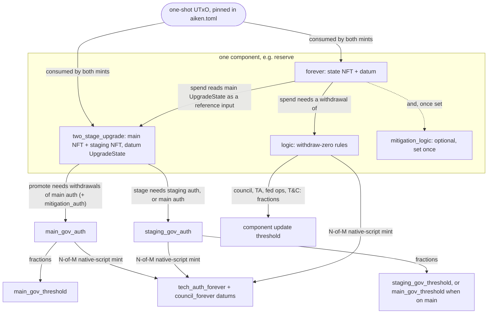
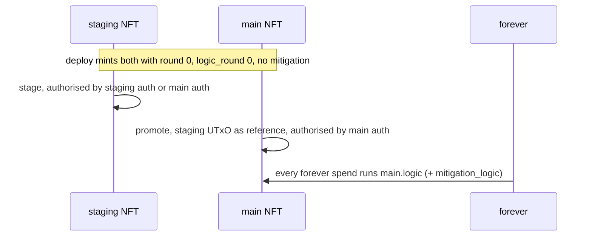

# Contracts architecture

The Aiken validators in `validators/` and `lib/` on `main`. Each claim below cites the source line, or the command that shows it. The full per-validator constraints are in [docs/governance/validators.md](../governance/validators.md); where that file and the code disagree, the code wins.

## The component pattern

Every governed component is three validators. The forever and two-stage mints consume the same one-shot UTxO:
- **forever** holds the state NFT and datum. Any spend needs the logic named on the main upgrade state to run as a withdrawal.
- **two-stage upgrade** holds a `main` and a `staging` NFT, each with an `UpgradeState` datum.
- **logic** is a withdraw-zero script with the rules.

Sources: the shared one-shot (`reserve.ak:16-20`, `reserve.ak:36-40`); the forever spend (`lib/forever/script.ak:36-61`); promote and stage auth (`lib/upgradable/two-stage-upgrade.ak:184`, `:281-290`); the auth scripts (`lib/auth/script.ak:15-46`, `lib/auth/staging.ak:54-96`); the logic quorum (`lib/logic/script.ak:93-137`); the native-script check (`lib/multisig/script.ak:92-121`).

### Components

`<c>` is the component's prefix in `aiken.toml` config keys.

| Component | `<c>` | Validators (file) | Logic | Logic threshold key |
|---|---|---|---|---|
| Reserve | `reserve` | `reserve_forever`, `reserve_two_stage_upgrade`, `reserve_logic` (`reserve.ak:14,32,47`); `reserve_logic_v2` (`reserve_v2.ak:7`); `reserve_staging_forever` (`staging_reserve_ics.ak:21`) | merge (`reserve.ak:51`) | none |
| ICS | `ics` | `ics_forever`, `ics_two_stage_upgrade`, `ics_logic` (`illiquid_circulation_supply.ak:14,29,41`); `ics_logic_v2` (`illiquid_circulation_supply_v2.ak:7`); `ics_staging_forever` (`staging_reserve_ics.ak:43`) | merge (`illiquid_circulation_supply.ak:45`) | none |
| Council | `council` | `council_forever`, `council_two_stage_upgrade`, `council_logic` (`permissioned.ak:55,73,88`); `council_logic_v2` (`permissioned_v2.ak:86`); `council_staging_forever` (`staging_permissioned.ak:57`) | multisig (`permissioned.ak:92-99`) | `main_council_update_threshold_hash` (`permissioned.ak:98`) |
| Tech auth | `technical_authority` | `tech_auth_forever`, `tech_auth_two_stage_upgrade`, `tech_auth_logic` (`permissioned.ak:104,122,137`); `tech_auth_logic_v2` (`permissioned_v2.ak:110`); `tech_auth_staging_forever` (`staging_permissioned.ak:79`) | multisig (`permissioned.ak:141-148`) | `main_tech_auth_update_threshold_hash` (`permissioned.ak:147`) |
| Federated ops | `federated_operators` | `federated_ops_forever`, `federated_ops_two_stage_upgrade`, `federated_ops_logic` (`permissioned.ak:153,171,186`); `federated_ops_logic_v2` (`permissioned_v2.ak:134`); `federated_ops_staging_forever` (`staging_permissioned.ak:101`) | multisig (`permissioned.ak:190-197`) | `main_federated_ops_update_threshold_hash` (`permissioned.ak:196`) |
| Terms & conditions | `terms_and_conditions` | `terms_and_conditions_forever`, `_two_stage_upgrade`, `_logic` (`terms_and_conditions.ak:21,39,54`); `terms_and_conditions_logic_v2` (`terms_and_conditions_v2.ak:35`); `terms_and_conditions_staging_forever` (`staging_tandc.ak:23`) | multisig (`terms_and_conditions.ak:58-65`) | `terms_and_conditions_threshold_hash` (`terms_and_conditions.ak:64`) |
| cNIGHT minting | `cnight_minting` | `cnight_mint_forever`, `cnight_mint_two_stage_upgrade`, `cnight_mint_logic` (`cnight_minting.ak:49,56,71`); `cnight_mint_logic_v2` (`cnight_minting_v2.ak:4`) | v1 always passes (`cnight_minting.ak:72-74`); v2 always fails (`cnight_minting_v2.ak:5-7`) | none |
| Committee bridge | `committee_bridge` | `committee_bridge_forever`, `committee_bridge_two_stage_upgrade`, `committee_bridge_logic` (`committee_bridge.ak:12,38,53`) | BEEFY proof (`committee_bridge.ak:57-84`) | `beefy_signer_threshold_hash` (`committee_bridge.ak:75`) |

Two components differ from the pattern:
- `cnight_mint_forever` holds no state NFT. It is a withdraw script that requires the logic and mitigation logic named on the cNIGHT main upgrade state (`cnight_minting.ak:10-46`). A minting policy then depends on that withdrawal; `test_cnight_minting_proxy` shows the chain (`test_cnight_minting_proxy.ak:7-19`). The production cNIGHT policy lives in a separate repository.
- The committee bridge has no v2 logic and no staging forever on `main`.

Governance-wide validators: `main_gov_auth` and `staging_gov_auth` (`gov_auth.ak:6,14`); `main_gov_threshold`, `staging_gov_threshold`, `main_council_update_threshold`, `main_tech_auth_update_threshold`, `main_federated_ops_update_threshold`, `beefy_signer_threshold` and `terms_and_conditions_threshold` (`thresholds.ak:36,125,140,155,181,196,211`).

Standalone validators, outside the pattern: `cnight_generates_dust` (`cnight_generates_dust.ak:41`), `registered_candidate` (`registered_candidate.ak:16`), `always_fails` (`always_fails.ak:8`), the test-only `tcnight_mint_infinite` (`test_cnight_no_audit.ak:7`) and `test_cnight_minting_proxy`, and the type-export `z_*` validators that always fail (`validator_types.ak:22-114`, `validator_types_v2.ak:3-11`).

### What each validator compiles in

Every hash and one-shot is a `config.*` constant, so it is part of the script hash.

| Role | Compiles in | Source |
|---|---|---|
| forever | `<c>_one_shot_hash`, `<c>_one_shot_index`, `<c>_two_stage_hash`, `cnight_policy` | `reserve.ak:16-25`; `lib/forever/script.ak:32` |
| two-stage upgrade | `<c>_one_shot_hash`, `<c>_one_shot_index`, `cnight_policy` | `reserve.ak:36-42`; `lib/upgradable/two-stage-upgrade.ak:453` |
| merge logic (reserve, ICS) | `<c>_forever_hash`, `cnight_policy`, `cnight_name` | `reserve.ak:51`; `lib/logic/script.ak:64-65` |
| multisig logic (council, TA, fed ops, T&C) | `<c>_forever_hash`, the component's threshold hash, `technical_authority_forever_hash`, `council_forever_hash` | `permissioned.ak:96-98`; `lib/logic/script.ak:112-131` |
| v2 state logic (the six `*_logic_v2` of reserve, ICS, council, TA, fed ops, T&C) | `<c>_logic_v2_one_shot_hash`, `<c>_logic_v2_one_shot_index`, `<c>_forever_hash`, `<c>_two_stage_hash`, `cnight_policy`; multisig v2 also the threshold, TA and council forever hashes; merge v2 also `cnight_name` | `reserve_v2.ak:10-21`; `permissioned_v2.ak:89-105`; `lib/logic/next_version.ak:74,83,102,167-184,216` |
| `cnight_mint_logic_v2` | nothing; it always fails | `cnight_minting_v2.ak:1-8` |
| staging forever | `<c>_staging_one_shot_hash`, `<c>_staging_one_shot_index`, `<c>_two_stage_hash`, `cnight_policy` | `staging_reserve_ics.ak:23-33`; `lib/forever/staging.ak:30` |
| `main_gov_auth` | `main_gov_threshold_hash`, `technical_authority_forever_hash`, `council_forever_hash`, `cnight_policy` | `lib/auth/script.ak:20,34,41,57` |
| `staging_gov_auth` | `council_two_stage_hash`, `main_gov_threshold_hash`, `staging_gov_threshold_hash`, `technical_authority_forever_hash`, `council_forever_hash`, `cnight_policy` | `lib/auth/staging.ak:59,64,69,84,91,110` |
| `main_gov_threshold` | `main_gov_one_shot_hash`, `main_gov_one_shot_index`, `technical_authority_forever_hash`, `council_forever_hash` | `thresholds.ak:43-47,90,97` |
| other thresholds | their own one-shot pair (`staging_gov_`, `main_council_update_`, `main_tech_auth_update_`, `main_federated_ops_update_`, `committee_threshold_`, `terms_and_conditions_threshold_`), plus `cnight_policy`, `main_gov_threshold_hash`, `technical_authority_forever_hash`, `council_forever_hash` | `thresholds.ak:129-218`; `lib/multisig/script.ak:141,159,174,181` |
| `cnight_mint_forever` | `cnight_minting_two_stage_hash`, `cnight_policy` | `cnight_minting.ak:42,51` |
| `committee_bridge_logic` | `committee_bridge_forever_hash`, `beefy_signer_threshold_hash` | `committee_bridge.ak:64,75` |

## What each role enforces

A summary; the constraint lists are in [validators.md](../governance/validators.md).

- **forever**:
  - Mint: consume the one-shot, mint exactly one empty-named token, send it to the script's own address with an inline datum, and pass the component's initial-state check (`lib/forever/script.ak:23-34`, `lib/utils.ak:82-108`).
  - Spend: the two-stage `main` NFT must be a reference input, and its datum's `logic` and (when set) `mitigation_logic` must run as withdrawals (`lib/forever/script.ak:36-61`, `lib/upgradable/two-stage-upgrade.ak:345-371`). The forever checks nothing about the outputs; the logic does.
- **two-stage upgrade**: mints the `main` and `staging` NFTs once, then validates stage and promote spends (see the lifecycle below; `lib/upgradable/two-stage-upgrade.ak:35-161`).
- **merge logic** (reserve, ICS): every input at the forever address joins one output at that exact address (no stake credential). The output holds only ADA and `cnight_policy`/`cnight_name`, at least the summed amounts, and no datum hash. The forever NFT may not be spent (`lib/logic/script.ak:17-78`). No signatures are needed. See [Reserve](../governance/validators.md#reserve-validators) and [ICS](../governance/validators.md#illiquid-circulation-supply-validators).
- **multisig logic** (council, TA, fed ops, T&C):
  - Reads the fractions from the threshold NFT in the reference inputs.
  - Requires tech-auth and council approval.
  - Validates the new forever datum with the component's structure check (`lib/logic/script.ak:83-147`; `permissioned.ak:15-52`; `terms_and_conditions.ak:12-18`).
  - Approval means the transaction mints under the N-of-M native script rebuilt from the body's `Versioned<Multisig>` datum, needing `ceil(total × numerator / denominator)` signers (`lib/multisig/script.ak:29-63`, `:92-121`). The ledger, not Plutus, checks the signatures.
- **gov auth**: `main_gov_auth` requires the same two approvals at `main_gov_threshold` (`lib/auth/script.ak:12-61`). `staging_gov_auth` uses `main_gov_threshold` when its own hash is the `auth` on the council's main upgrade state, else `staging_gov_threshold` (`lib/auth/staging.ak:15-71`). See [Governance Auth](../governance/validators.md#governance-auth-validators).
- **thresholds**:
  - Mint once, with `0 ≤ numerator < denominator` for both fractions (`thresholds.ak:16-30`, `lib/multisig/script.ak:134-144`).
  - Spend: needs TA and council approval at `main_gov_threshold`'s fractions. `main_gov_threshold` itself uses the fractions in its own datum. The NFT stays at its address with a valid datum (`lib/multisig/script.ak:146-199`; `thresholds.ak:57-117`).
  - `beefy_signer_threshold` validates a `BeefyThreshold` instead (`thresholds.ak:171-178`, `:206`).
  - See [Governance Thresholds](../governance/validators.md#governance-threshold-validators).
- **committee bridge logic**: verifies a BEEFY consensus proof against the input state, the output state and the `BeefyThreshold` reference input (`committee_bridge.ak:53-86`). See [Committee Bridge](../governance/validators.md#beefy-backed-committee-bridge-validators).

## The upgrade lifecycle

`UpgradeState` is `{logic, mitigation_logic, auth, mitigation_auth, round, logic_round}` (`lib/upgradable/types.ak:4-12`). The two-stage redeemer names the field (`Logic | Auth | MitigationLogic | MitigationAuth`) and the stage: `Main(staging_ref)` to promote, or `Staging(main_ref, new_hash)` to stage (`lib/upgradable/types.ak:14-30`).

- **Deploy.** One mint of exactly `main` and `staging` under the two-stage policy consumes the one-shot. `outputs[0]` is `main` and `outputs[1]` is `staging`, both at the script address, both `UpgradeState{logic, "", auth, "", 0, 0}` with 28-byte `logic` and `auth` (`lib/upgradable/two-stage-upgrade.ak:374-455`).
- **Stage** (`Staging`): spends the staging NFT with the main UTxO as a reference input at the same address (`:106-130`).
  - The new hash must be 28 bytes (`:259`).
  - Authorised when the staging datum's `auth` (and `mitigation_auth`) run, or the main datum's do, the recovery path when staging is stuck (`:281-290`).
  - Staging `Logic` increments `logic_round` (`:293-301`); `Auth`, `MitigationLogic` and `MitigationAuth` increment `round` (`:303-339`).
- **Promote** (`Main`): spends the main NFT with the staging UTxO as a reference input at the same address (`:70-104`).
  - Always needs the main datum's `auth` and `mitigation_auth` (`:184`).
  - `Logic` copies `logic` and `logic_round` from staging; `Auth` copies `auth` and `round` (`:186-212`).
- **Both spends**: the output at the script address keeps the NFT and carries exactly the expected datum (`:142-156`).
- **Mitigation.** `mitigation_logic` and `mitigation_auth` can be set once each: staging and promoting them requires main's to be empty (`:313-339`, `:214-246`). Once set, `mitigation_logic` must run in every forever spend (`lib/forever/script.ak:60`), and `mitigation_auth` beside `auth` in every promote and every stage (`:184`, `:282-290`, `validate_running` at `:345-371`). The one exception: staging `MitigationAuth` under the staging auth ignores the staging datum's `mitigation_auth` (`:283-287`).
- **`round` vs `logic_round`.** The upgrade state counts staged logic changes in `logic_round` and the other changes in `round`. The forever datum has its own `logic_round` (`Versioned`, `lib/forever/types.ak:1-5`; `FederatedOps`, `:35-40`), and some logic structure checks pin it:
  - v1 council and TA pin 0 (`permissioned.ak:16`); v1 T&C pins 0 (`terms_and_conditions.ak:13`).
  - v2 council and TA pin 1 (`permissioned_v2.ak:15`); v2 T&C pins 1 (`terms_and_conditions_v2.ak:11`); v2 federated ops pins 2 (`permissioned_v2.ak:48`).
  - v1 federated ops only checks that the datum decodes as `FederatedOps` (`permissioned.ak:48-52`), and the reserve and ICS merge logic has no structure check (`lib/logic/script.ak:17-78`).

  No validator ties the two counters together.

### The v2 logic path

The six v2 state logics (every `*_logic_v2` except `cnight_mint_logic_v2`, which always fails and calls nothing, `cnight_minting_v2.ak:1-8`) call `lib/logic/next_version.ak`: `logic_merge_v2` for reserve and ICS, `logic_multisig_validation_nft_input_v2` for the rest.
- **One-shot state.** Each of the six is also a minting policy. Its one-shot mint creates a `StagingState{cnight_test_policy, forever_script_hash}` NFT (`next_version.ak:95-106`, `:209-220`; `lib/logic/types.ak:3-7`).
- **Main or staging.** On a withdrawal it checks whether it is the `logic` on its component's main upgrade state, from the reference inputs (`logic_is_on_main`, `lib/upgradable/two-stage-upgrade.ak:459-489`; called at `next_version.ak:82,138,195`). If it is, it acts on the main forever. If not, it reads `StagingState` and acts on the forever and cNIGHT policy named there (`next_version.ak:84-91`, `:143-153`).
- **Redeemer.** The multisig v2 redeemer is `LogicRedeemer` (`lib/logic/types_v2.ak:4-7`):
  - `Normal(inner)` runs the v1 quorum and structure checks with `inner` (`next_version.ak:134-190`, `:225`).
  - `Migrate` checks only that the forever datum moves from the v1 shape to the v2 shape, data unchanged (`next_version.ak:192-206`, `:226`). The migrations: `permissioned_v2.ak:55-62` (multisig, round 0 → 1), `:66-83` (`FederatedOps` → `FederatedOpsV2`) and `terms_and_conditions_v2.ak:20-32`. `Migrate` has no quorum check.
- **Unregistering** a multisig v2 logic's stake credential requires the same transaction to withdraw from that credential with a redeemer other than `Migrate`. Without such a withdrawal the `expect` fails (`next_version.ak:230-240`). The merge v2 logic runs its full validation on unregistering (`next_version.ak:108-112`).

### The staging track

The `staging_*` validators are forever validators that read the **staging** NFT where the normal forever reads `main` (`lib/forever/staging.ak:37-44` vs `lib/forever/script.ak:39-46`). Everything else is the same. Each has its own one-shot and compiles in the component's two-stage hash (`staging_reserve_ics.ak:21-58`, `staging_permissioned.ak:57-116`, `staging_tandc.ak:23-38`). A staging-forever UTxO is therefore spendable by whatever logic is staged. A staged v2 logic can then act on test state on the same network before promote, which is what `StagingState.forever_script_hash` points it at (`next_version.ak:84-91`). The structural issues below block this path today.

## The audit map

- **Audit status:** nothing v2 was audited.
- **Edit policy** (CLAUDE.md, "Audited Aiken Files"):
  - Files that existed at commit `ca38d87` are immutable. `lib/auth/staging.ak` is the one exception and may be edited.
  - New v2 code goes in `*_v2.ak` files; new types go in `lib/logic/types_v2.ak`.
  - The post-audit staging files, `validators/staging_*.ak` and `lib/forever/staging.ak`, are freely editable.
  - `lib/logic/next_version.ak` is unaudited, but it existed at `ca38d87`, so it is immutable too.

Editing any validator changes its script hash. Deployed hashes live in `deployed-scripts/<env>/plutus.json`, and `build --from-deployed` builds against them (`cli/contracts/build.ts:568-645`).

## Config and hash pinning

- **Profiles.** `aiken.toml` has one `[config.<env>]` profile per network: `default`, `preview`, `qanet`, `govnet`, `devnet`, `preprod`, `mainnet`, `local` (`aiken.toml:18,264,509,754,999,1244,1490,1736`).
- **Build.** `just build <env>` runs `vpx cli/main.ts build -n <env>` (`Justfile:6-7`). That runs `aiken build -S --env <env>` (`cli/contracts/build.ts:432-461`), so every `config.*` read becomes a compile-time constant of that profile.
- **Hash touches.** Validators that would otherwise not depend on `cnight_policy` still compare it against something, so that it feeds the script hash (e.g. `lib/forever/script.ak:31-32`, `lib/upgradable/two-stage-upgrade.ak:452-453`).
- **Hand-set values.** One-shot hashes and indices are set by hand per profile, e.g. `aiken.toml:20-49` for `default`.

The standard build (`buildStandard`, `cli/contracts/build.ts:505-566`) compiles the whole project five or more times and writes hashes back into the profile between compiles:

```mermaid
flowchart LR
  c0["compile"] --> p0["cnight_policy := tcnight_mint_infinite hash (not mainnet)"]
  p0 --> c1["compile"] --> p1["two-stage hashes (6 core + cnight_minting)"]
  p1 --> c2["compile"] --> p2["forever hashes (6 core + cnight_minting)"]
  p2 --> c3["compile"] --> p3["threshold hashes (6)"]
  p3 --> c4["final compile"] --> p4["refresh all three groups"]
  p4 --> v["verify logic bytecode embeds threshold hashes; rebuild once if stale"]
```

| Step | Writes | Source |
|---|---|---|
| initial compile | `cnight_policy` := `tcnight_mint_infinite`'s hash; skipped on mainnet | `cli/contracts/build.ts:509-527`, `:245-269` |
| phase 1 | `<c>_two_stage_hash` for the six core components and cNIGHT minting | `cli/contracts/build.ts:529-533`, `:64-93` |
| phase 2 | `<c>_forever_hash`, same set | `cli/contracts/build.ts:535-539`, `:95-121` |
| phase 3 | the six `*_threshold_hash` keys except BEEFY | `cli/contracts/build.ts:541-546`, `:123-148` |
| final | recompiles and refreshes all three groups | `cli/contracts/build.ts:548-554`, `:463-498` |
| verify | `council_logic`, `tech_auth_logic`, `federated_ops_logic` and `main_gov_auth` bytecode must contain their threshold hash; one rebuild, then fail | `cli/contracts/build.ts:463-498`, `:150-168`, `:373-401` |

The order follows the compile-time dependencies:
- **two-stage** depends only on its one-shot and `cnight_policy`.
- **forever** depends on the two-stage hash (`reserve.ak:25`).
- **thresholds** depend on the TA and council forever hashes (`thresholds.ak:90,97`).
- **logic and auth** depend on forever and threshold hashes (`permissioned.ak:96-98`, `lib/auth/script.ak:20`).

The would-be cycle between forever and logic is broken at run time: the forever reads the logic hash from the main upgrade datum instead of compiling it in (`lib/forever/script.ak:40-60`).

Not pinned by the engine:
- the committee bridge's `committee_bridge_two_stage_hash`, `committee_bridge_forever_hash` and `beefy_signer_threshold_hash`, and `bridge_signer_threshold_hash` (absent from the mappings, `cli/contracts/build.ts:64-148`);
- every v2 state-logic and staging one-shot (hand-set per profile).

The verify step does not cover `terms_and_conditions_logic` or any v2 logic (`cli/contracts/build.ts:150-168`). `build --from-deployed` pins the core two-stage, forever and threshold hashes from `deployed-scripts/<env>/plutus.json` in `aiken.toml`, runs the phased build with them (a pinned key keeps its pin; `--components` compiles the named components from new; a pinned validator that compiles to another hash fails the build), and restores `aiken.toml` (`cli/contracts/build.ts:568-645`, `:331-371`).

## Known structural issues

1. **The v2 staging NFT is a dead end.**
   - A v2 state logic mints its `StagingState` NFT to its own script address: `input_linked_mint` requires the output at `Script(own_policy)` (`next_version.ak:96-97`, `lib/utils.ak:53-60`, `:105`).
   - On the staging branch, the logic looks that NFT up among the spent **inputs** (`next_version.ak:85`, `:144`, `:198`).
   - Spending it runs the v2 logic with a spend purpose, which falls through to `fail` (`next_version.ak:116`, `:244`).
   - So the staging branch can never validate: a v2 state logic can act only once it is promoted to main.
2. **v2 state-logic scripts push the promote transaction over the size limit.** If the promoted logic's stake credential is not registered, `promote-upgrade` registers it in the same transaction. The Conway registration needs the script as a witness (`cli/governance/two-stage.ts:788-807`, `:469-489`; `cli/tx.ts:370-377`). The transaction then carries these scripts inline (`cli/governance/two-stage.ts:411-427`, `cli/governance/multisig.ts`, `governanceAuthorityPlan`):

   | Script | Size, `just build` (`-t verbose`) | Size, `-t silent` |
   |---|---|---|
   | two-stage upgrade, deployed on mainnet | 8,274 B | — |
   | `main_gov_auth`, deployed on mainnet | 1,787 B | — |
   | two native multisig scripts | small | — |
   | v2 state logic, smallest (reserve, ICS) | 3,592 B | 2,138 B |
   | v2 state logic, largest (federated ops) | 5,214 B | 2,502 B |

   Sizes are `compiledCode` length ÷ 2, read with `jq` from `deployed-scripts/mainnet/plutus.json` and `plutus-default.json`. The silent column comes from `aiken build -S --env default -t silent` on a scratch copy.
   - The limit is `maxTxSize` 16,384 B: mainnet's value (`docs/bridge/spec.md:350-351` on `bridge/aiken`) and Blaze's hard-coded default (`node_modules/@blaze-cardano/core/dist/index.mjs:351`, version 0.10.1).
   - A federated-ops v2 promote measured 17,147 B (`plans/effect/05-commands-deploy-submit.md:330-334` on `feat/committee-bridge-block-rewards-impl`).
   - The architecture review of 2026-11-11 chose reference scripts in the CLI as the fix, with no Aiken change.
3. **v2 copies drift from their originals.** The v2 files copy code from their originals rather than call it:
   - `validate_multisig_structure_v2` (`permissioned_v2.ak:14-45`) is `permissioned.ak:15-46` with `logic_round: 1`.
   - `logic_merge_v2`'s `merge_values` (`next_version.ak:33-78`) is `lib/logic/script.ak:24-69` with the cNIGHT policy as a parameter.
   - The quorum block (`next_version.ak:156-189`) repeats `lib/logic/script.ak:98-136`.

   The staging track copies immutable code the same way (`staging_permissioned.ak:13-50`, `staging_tandc.ak:10-16`, `lib/forever/staging.ak`). Nothing compares the copies with their originals.
4. **The committee bridge is not wired into the build** (found while writing this page).
   - The engine never pins its hashes (issue list above).
   - In the `default`, `preprod`, `mainnet` and `local` profiles, `beefy_signer_threshold_hash` is 32 bytes, so no script has that hash (`aiken.toml:228-230`).
   - Built from those profiles, `committee_bridge_logic` cannot find its threshold input (`committee_bridge.ak:72-76`).
