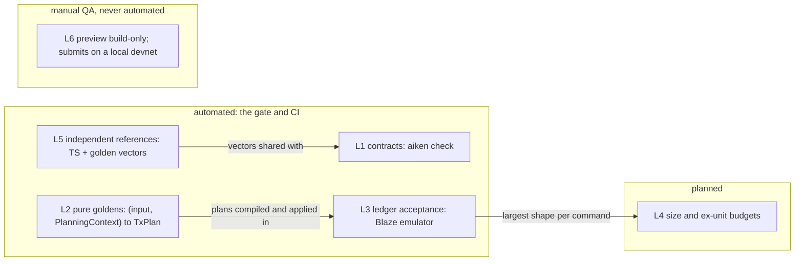

# Testing architecture

The test layers decided on 2026-11-11, and what exists of each with the Effect 4 CLI. Counts come from one run of the gate `just fmt && just build && just check && vp test` on `cli/effect4` (the commit that adds this page):
- `aiken check`: 64 tests (64 unit, 0 property).
- `vp test --reporter=json`: 331 tests (331 pass, 0 fail, 0 skipped), 25 files.



## Rules

- **Function-level only.** Tests call functions: plans, parsers, programs over layers. They never drive the CLI binary or parse argv ([cli.md](cli.md#tests)).
- **No network in tests.** Submitting to a network is manual QA, never a test. Programs that submit (`sign-and-submit`) run in tests only over the Blaze emulator. Signing tests check that the witnesses written into a transaction verify against its id (`tests/signing.test.ts`).
- **No Effect `TestClock`**; use `it.live`.
- **Today:**
  - No test spawns a process: `grep -E 'Bun\.spawn|spawnSync|execSync|execFileSync|child_process'` over `tests/` finds nothing.
  - No test calls `fetch` or builds a network provider: `grep -E 'fetch\(|new (Blockfrost|Kupmios)'` finds nothing. HTTP is a stub `HttpClient` layer where a program asks for one (e.g. `tests/chain.test.ts`).

## Layers

| Layer | What | Oracle | Today |
|---|---|---|---|
| L1 contracts | Aiken unit tests; a mutation table per "Fail if" clause; property tests (aiken-lang/fuzz) for MIP rules | the script under mutation | 64 unit tests in 5 modules; no mutation table; no property tests |
| L2 pure goldens | `(input, frozen PlanningContext) → TxPlan` per command | plans written by the Effect 3 CLI for the same inputs | 34 plan goldens in 5 files |
| L3 ledger acceptance | build the transaction and apply it on the Blaze emulator, phase 1 and phase 2 | the emulator ledger | builders in 9 files; command programs in 6 |
| L4 budgets | size and ex-unit snapshot per command at its largest shape, failing over the protocol limits | protocol parameters | planned, not built |
| L5 independent references | TS references for MIP rules, golden vectors shared with Aiken | an independent implementation | committee bridge, on its branch only |
| L6 manual QA | build-only on preview; submits only on a local devnet; never automated against a public network | the real ledger | by hand; no devnet tooling in the repository |

### L1 contracts

- **What runs.** `just check` runs `aiken check -S -t verbose` (`Justfile:10-12`, `:15`). CI runs `aiken fmt --check`, `aiken check` and `aiken build` (`.github/workflows/continuous-integration.yml:16-18`) on aiken v1.1.21 (`:15`), the version `aiken.toml:3` names.
- **The 64 tests**, by module (the `modules[].summary` of the `aiken check` JSON):

  | Module | Tests |
  |---|---|
  | `lib/upgradable/two-stage-upgrade.test.ak` | 39 |
  | `validators/reserve.test.ak` | 16 |
  | `lib/bridge/beefy.test.ak` | 4 |
  | inline in `lib/bridge/codec.ak` | 4 |
  | `lib/multisig/script.test.ak` | 1 |

  No Aiken test module covers gov auth, the thresholds, the permissioned or T&C validators, cNIGHT minting, the v2 logic or the staging forever validators. The v2 logic runs only at L3: the federated-ops v2 migration (`tests/operations.test.ts`) and stages and promotes of v2 logic hashes (`tests/upgrade.test.ts`).
- **No property tests.** The only dependency is `aiken-lang/stdlib` (`aiken.toml:13-16`); `aiken-lang/fuzz` is absent.
- **No mutation table.** `docs/governance/validators.md` states constraints as tagged rules (e.g. `MS-1`), with no "Fail if" clauses (`grep -c 'Fail if'` gives 0), and nothing records mutation runs against them. The method is recorded once, on `staking/aiken`: one clause disabled per `aiken check` run on a scratch copy, 50 mutants, 49 killed, the survivor an equivalent mutant (`plans/staking/01-reserve-release.md:89-91`).

### L2 pure goldens

Planning is a pure function of the input and a frozen PlanningContext, so a test builds the context from fixtures, calls `planX(ctx)` and compares the plan (as JSON, `planJson` in `tests/helpers/wallet-scenario.ts`) with a golden under `tests/golden/`. The goldens were written by the Effect 3 CLI the rewrite replaced, for the same inputs, over one chain state per family that both CLIs could run:

| Golden directory | Plans | Test | Scenario |
|---|---|---|---|
| `wallet/` | simple-tx, mint, burn, merge-utxos | `tests/wallet.test.ts` | `tests/helpers/wallet-scenario.ts` |
| `governance/` | change-council, change-tech-auth, change-terms, change-federated-ops | `tests/governance.test.ts` | `tests/helpers/governance-scenario.ts` |
| `operations/` | migrate-federated-ops, mint-staging-state, register-gov-auth, register-cnight-mint-logic, run-cnight-mint-mainnet | `tests/operations.test.ts` | `tests/helpers/operations-scenario.ts` |
| `upgrade/` | stage-upgrade, promote-upgrade | `tests/upgrade.test.ts` | `tests/helpers/upgrade-scenario.ts` |
| `deploy/` | the 13 deploy and 6 staging-track steps | `tests/deploy.test.ts` | `tests/helpers/deploy-scenario.ts` |

`tests/golden/simple-tx/` and `tests/golden/signing/` hold transaction files the signing tests read (`tests/signing.test.ts:60`, `:132`).

### L3 ledger acceptance

- **Builders.** `emulator.expectValidTransaction(blaze, builder)` completes, signs and submits a transaction to the in-process emulator (`node_modules/@blaze-cardano/emulator/dist/emulator-CPef1Omq.mjs:544-556`, version 0.5.4). Submit rejects a transaction over `maxTxSize` and then evaluates the scripts (`:944-946`). Nine files build their transactions this way: `basic_deploy`, `change-terms-cli`, `change_auth_member`, `cnight-minting`, `cnight_generate_dust`, `deploy_thresholds`, `mainnet_merge_transactions`, `stage_auth_all`, `tech_council_upgrade` (plus the deploy helpers, `tests/helpers/deploy.ts`).
- **Command programs.** Six files run the CLI's own programs over `Provider.over(new EmulatorProvider(emulator))` and submit their transaction files with `signAndSubmitProgram`: `wallet`, `governance`, `operations`, `upgrade`, `deploy`, `signing`. Two limits of the emulator shape them:
  - it runs no native script, so it refuses the authorities' vkey witnesses as extraneous: files with authority witnesses are submitted unsigned, and a separate test checks a signed file's witnesses (`tests/governance.test.ts`);
  - it takes no transaction that spends from its mempool, so chained deployment transactions are submitted one at a time (`tests/deploy.test.ts`).
- **Mainnet scripts.** `tests/mainnet_merge_transactions.test.ts` and the "Mainnet snapshot upgrade transactions" of `tests/upgrade.test.ts` run against the deployed mainnet scripts and snapshot UTxOs (`tests/helpers/mainnet-snapshot.ts`).
- **Parameters.** Tests construct `new Emulator([])`, which uses Blaze's hard-coded parameters, `maxTxSize: 16384` (`node_modules/@blaze-cardano/core/dist/index.mjs:351`).
- **Function-level unit tests.** The other files call parsers, codecs and services directly: `build` 22, `chain` 16, `config` 46, `datum` 18, `generate-key` 4, `input` 11, `report` 26, `resolver` 29, `snapshot` 22, `tx` 12 (tests per file).
- **Build first.** Tests read the build output: 24 files under `tests/` reference `contract_blueprint*` or `plutus*.json`. Run `just build` before `vp test`, and again after any validator or `aiken.toml` change; the gate does both, in that order.

### L4 budgets

Planned, not built: no test records a size or ex-unit budget per command.
- L3 rejects only the transactions a test happens to build. The federated-ops v2 promote at 17,147 B, over the 16,384 B limit, was found on a live network (`plans/effect/05-commands-deploy-submit.md:330-334` on `feat/committee-bridge-block-rewards-impl`; see [contracts.md](contracts.md#known-structural-issues)).
- `compile` refuses a transaction over the protocol's `maxTxSize` once it carries its expected vkey witnesses (`cli/tx.ts`, `sizeAtSubmit`), so the CLI does not write such a file; no test pins the size of each command's largest shape.
- The interactive harness in `pi-code/test-plan` raises `maxTxSize` to 50,000 (`pi-code/test-plan/lib/provider.ts:114`, `:316`), so it cannot see an oversized transaction.

### L5 independent references

The committee bridge has one, on bookmark `bridge/aiken` (also on `feat/committee-bridge-block-rewards-impl`), not here:
- the TS reference: 10 modules in `tests/bridge/reference/`, driven by `tests/bridge/reference.test.ts`;
- 11 golden vector files in `tests/vectors/bridge/`;
- the Aiken fixtures that consume them, `lib/fixtures/bridge/vectors.ak`;
- the plan, `plans/bridge/05-ts-reference-vectors.md`.

Staking gets one later.

### L6 manual QA

- **Build-only on preview.** `just build preview` builds against the preview profile (`Justfile:6-7`).
- **Submitting.**
  - In the CLI the only submit path is `Provider.submit` (`cli/chain.ts:351-352`), reached through `submitTransaction` (`cli/signing.ts:355`) from `sign-and-submit` and `combine-signatures` (`cli/signing.ts:534`, `:694`). CLAUDE.md forbids running either without asking.
  - `pi-code/test-plan` also submits to a real network (`pi-code/test-plan/lib/provider.ts:1175`). In its non-interactive mode it auto-confirms each submission when no recorded answer exists (`:1145-1153`).
- **Local devnet.** `just private-net-up` is on bookmark `beefy-mip-corrections` (its `Justfile:55`, `plans/bridge/07-private-network.md`), not here.
- `pi-code/test-plan` is an interactive journey runner (`pi-code/test-plan/README.md`). Neither `vp test` nor CI runs it.

## Running

```bash
just fmt && just build && just check && vp test   # the gate (CLAUDE.md)
vp test tests/basic_deploy.test.ts                 # one file
```

`just check` runs `aiken check -S -t verbose`, `vp check` (oxlint, oxfmt) and `vp exec tsc --noEmit` (`Justfile:10-17`). CI runs `aiken fmt --check`, `aiken check` and `aiken build` on aiken v1.1.21, then `setup-vp` with `vp install --frozen-lockfile`, `vp check`, `vp exec tsc --noEmit` and `vp test` (`.github/workflows/continuous-integration.yml:13-27`).
