# Transactions

These diagrams show every transaction of `night_staking`, `night_registration` and Reserve logic v2. The contracts and the CLI are built to match them.

Sources:

- Diagrams 1–9: the staking MIP (midnight-improvement-proposals PR 421, at commit ab25a20d).
- Diagrams 10–15: the Cardano Reserve Release MIP (PR 406) and change `pmlmqpwo`.
- Diagrams 16–19: the two-stage upgrade code (`lib/upgradable/two-stage-upgrade.ak`, `validators/reserve.ak`, `validators/gov_auth.ak`).

`just tx-diagrams` renders `staking.typ`, `registration.typ` and `reserve.typ` into `svg/` with Typst 0.15. `tx.typ` holds `vanilla_transaction`, copied from the audit report template.

## How to read them

- A script name such as `night_staking` stands for the script's hash. As an address, the name means the payment credential `Script(hash)`; as a token, the name means the script's policy with the empty asset name. "No stake part" means an address without a stake credential.
- A purple line is a script input, labelled with its spend redeemer. A dashed line is a reference input.
- Inputs and reference inputs appear in no particular order. We do not sort them: the ledger sorts a transaction's inputs, and its reference inputs, by transaction id and output index. No script may depend on their position.
- Outputs keep the order the builder gives them. A note says so when a script depends on output order.
- Lowercase letters (`c`, `p`, `t`) name values that a diagram relates. A primed letter (`p'`) is the new value.
- A valid range shows the bounds as the scripts see them: the ledger turns the slots into POSIX ms, with the lower bound inclusive and the upper bound exclusive.
- Constants in backticks (`lock_deposit_lovelace`, `UNBONDING_DELAY`, `night_registration_hash`, `release_interval_ms`, `release_initial_reserve_star`, the init tokens' seed UTxO `reserve_logic_v2_init_one_shot_hash` and `reserve_logic_v2_init_one_shot_index`, the staging params' seed UTxO `reserve_staging_params_one_shot_hash` and `reserve_staging_params_one_shot_index`) come from the network's aiken.toml profile.
- cNIGHT and NIGHT are the asset `cnight_policy`, `cnight_name` of the profile.
- Change outputs are drawn for completeness. No contract checks them, and the wallet may split or merge them freely.
- Fees and change come from any wallet input. The diagrams leave out inputs that only carry reference scripts, because no rule reads them; a script can come by reference or in the witness set.
- When an owner is a script `h`, the transaction withdraws any amount from `h`. The ledger makes the amount the account's whole balance, normally 0, and the contract checks only that the withdrawal is there.
- "open:" in a note marks a choice the sources leave open. The diagram shows the simplest choice.

## night_staking

### 1. Register the stake credential

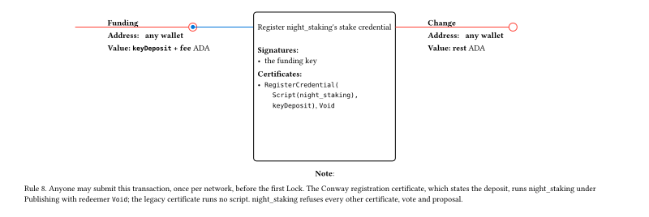

- Rule 8: the publish purpose accepts only a stake credential registration. Delegation, unregistration, votes and proposals fail.
- Redeemer (user decision, 11-17; it replaces the MIP's rule 7 reading of the kind from the shape): the withdrawal's redeemer is `Lock`, `Update`, `Unbond` or `Unlock`, and each accepts exactly one transaction shape. The mint and spend purposes read no redeemer; they need only the withdrawal (rule 6).

### 2. Lock

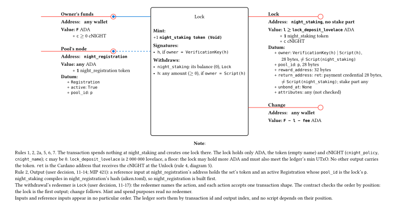

- Rule 1: the mint is exactly one token with the empty name, quantity 1.
- Rule 2: the output carries the token and an inline `DelegationLock`, and its address has no stake part. `owner` holds a 28-byte hash and is not `Script(night_staking)`. `pool_id` is 28 bytes and `reward_address` 32. The payment credential of `return_address` holds a 28-byte hash and is not `Script(night_staking)`; its stake part may be anything (MIP 421). `unbond_at` is `None`. The contract does not check `attributes` (user decision, 11-13). The value holds only ADA, the token and cNIGHT, with at least `lock_deposit_lovelace` (2,000,000 lovelace, a floor) of ADA.
- Rule 2, Output (user decision, 11-14; MIP 421): a reference input at night_registration's address holds only ADA and the set's token, and an active Registration whose `pool_id` is the lock's (exact value: user decision, 11-17). night_staking compiles in `night_registration_hash`, so night_registration is built first.
- Rule 5: the output datum's `owner` authorizes the transaction.
- Rule 6: the mint needs the withdrawal from `Script(night_staking)`.
- Rule 7: the redeemer is `Lock`. The transaction spends nothing at night_staking, its first output is the lock, no other output sits at night_staking or carries the token, and the contract checks that order (user decision, 11-17). In every transaction, an input at night_staking must be a lock whose value holds only ADA, the token and cNIGHT (user decision, 11-17).

### 3. Update a lock

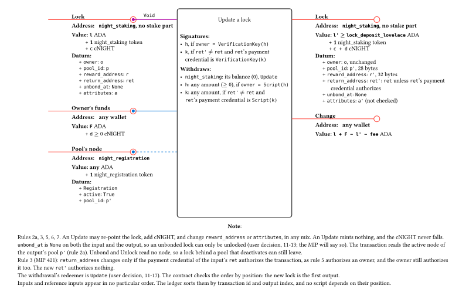

- Rule 3, Update (user decision, 11-13; the MIP will say so): `unbond_at` is `None` on both the input and the output. The output meets rule 2. `owner` does not change, and the cNIGHT does not fall.
- Rule 3, return address (MIP 421): `return_address` changes only if the payment credential of the input's `return_address` authorizes the transaction, a key by its signature and a script by a withdrawal from it. The owner must authorize as well; the new return address authorizes nothing.
- Rule 3, Output: the transaction reads the active node of the output's pool only when the Update changes `pool_id`. Unbond and Unlock read no node, so a lock behind a pool that deactivates can still leave.
- Rule 5: the input datum's `owner` authorizes the transaction.
- Rules 6 and 7: the spend needs the withdrawal, whose redeemer is `Update`. The transaction spends one lock, its first output is the new lock, no other output sits at night_staking or carries the token, and it mints nothing; the contract checks that order (user decision, 11-17).

### 4. Unbond a lock

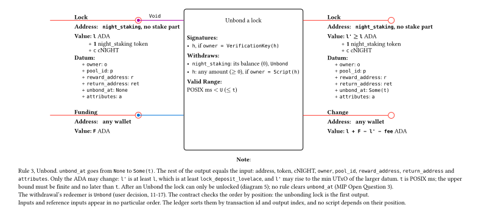

- Rule 3, Unbond (MIP 421): `unbond_at` goes from `None` to `Some(t)`, and `t` is the upper bound of the validity interval. The rest of the output equals the input: address, token, cNIGHT, `owner`, `pool_id`, `reward_address`, `return_address` and `attributes`. Only the ADA may change, and the output's ADA is no less than the input's: the larger datum may need a higher min UTxO.
- After an Unbond the lock can only be unlocked (diagram 5).
- Rules 5, 6 and 7 apply as in diagram 3, with redeemer `Unbond`.

### 5. Unlock a lock

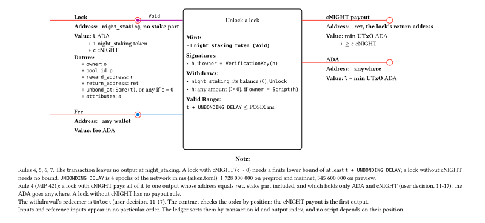

- Rule 4, Burn: the mint is exactly the spent token, quantity −1. A lock with cNIGHT needs `unbond_at = Some(t)` and a lower bound of at least `t + UNBONDING_DELAY`. A lock without cNIGHT can be unlocked at once, whatever its `unbond_at`.
- Rule 4, payout (MIP 421): a lock with cNIGHT pays all of it to one output whose address equals the input datum's `return_address`, stake part included, and whose value holds only ADA and cNIGHT (user decision, 11-17). The ADA goes anywhere. A lock without cNIGHT has no payout rule.
- Rule 5: the input datum's `owner` authorizes the transaction.
- Rules 6 and 7: the spend and the burn need the withdrawal, whose redeemer is `Unlock`. The transaction spends one lock and creates no output at night_staking. A lock with cNIGHT pays it in the first output, and the contract checks that order (user decision, 11-17).

## night_registration

The set is two sorted linked lists. Each link names the node before; the first node of a list links to `#""`. The Tail is always the last node of both lists and holds no key: `Tail.prev_crch` names the last node of the crch list, which holds every node, Reserved and Registration, active or not, and `Tail.prev_pool` the last active Registration of the pool list. For example, with active Registrations 1 and 4 and Reserved nodes 2 and 3:

```
crch list: node 1 ← Reserved 2 ← Reserved 3 ← node 4 ← Tail
pool list: node 1 ← node 4 ← Tail
```

A new node's anchor in a list is the node after it there. The anchor is the Tail when the new key sorts after the last node in that list.

- The crch list sorts by length, then by bytes, so `#""` is the smallest key and a longer `crch` comes after a shorter one (user decision, 11-18). The pool list sorts `pool_id`, always 28 bytes, by bytes.
- `prev_pool` is a plain ByteArray on every node, Tail and Registration (user decision, 11-13; the MIP has `Option<ByteArray>`). An inactive node holds `prev_pool = #""`, and `active: False` marks the node as outside the pool list.
- A Registration's fields come in this order (user decision, 11-14): `active`, `crch`, `prev_crch`, `pool_id`, `prev_pool`, `owner`, `crch_signature`, `keys`, `signatures`, `reward_address`, `fixed_cost`, `attributes`: the fields a node keeps first, then the fields Deactivate clears.
- Node addresses have no stake part (rule 9, user decision, 11-14).
- A node holds only ADA and one token with the empty name, whether it is created, spent or read; a UTxO with night_registration's payment credential and anything else, whatever its stake part, cannot be spent (rule 9, user decisions, 11-16 and 11-17).
- Rule 9, size: every node datum, as `serialise_data` encodes it with `prev_crch` and `prev_pool` set to `#""`, is at most `NODE_DATUM_MAX` (4,500 bytes, `aiken.toml`). The contract checks no length for `crch` or `crch_signature`; `pool_id` and the owner hash are 28 bytes, `reward_address` 32, and `fixed_cost` is from 0 to 2^128 − 1.
- Withdrawal (user decision, 11-17: "withdraw checks everything"): every transaction at night_registration withdraws 0 from `Script(night_registration)`. That withdrawal runs every rule once; the mint and every spend only require it, as night_staking's rule 6. Its redeemer is `Init`, `CreateTwoAnchors` (diagram 7a), `CreateOneAnchor` (diagram 7b), `Update` or `Deactivate`, and each accepts exactly one transaction shape. The mint and spends read no redeemer. Outputs that are not nodes never sit at night_registration's address or carry its token.

### 0. Register the stake credential

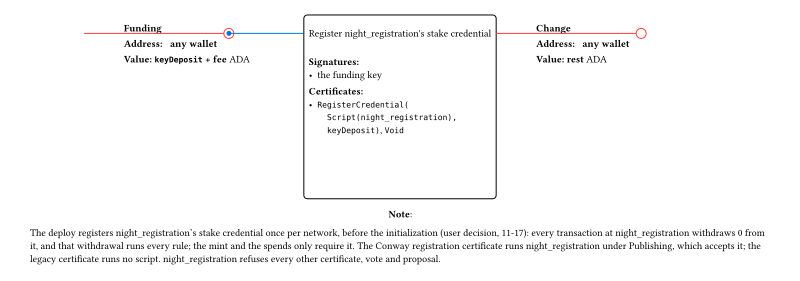

- The deploy registers night_registration's stake credential once per network, before the initialization (user decision, 11-17). The publish purpose accepts only that registration; delegation, unregistration, votes and proposals fail.

### 6. Initialize the set

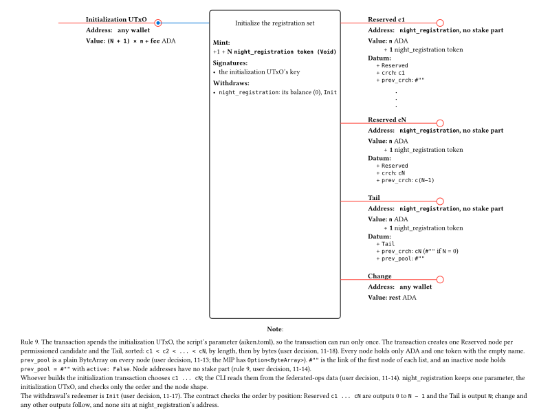

- Rule 9: the transaction spends the initialization UTxO, the script's parameter, and creates one Reserved node per permissioned candidate and the Tail. Every node holds only ADA, one token with the empty name and an inline `Node` datum. The crch list is sorted.
- Whoever builds the initialization transaction chooses the permissioned candidates' `crch` values; the CLI reads them from the federated-ops data (user decision, 11-14). night_registration keeps one parameter, the initialization UTxO, and checks only the order and the node shape.
- The withdrawal's redeemer is `Init`. The contract checks the order by position (MIP 421): the Reserved nodes are the first outputs, in crch order, then the Tail, and change follows.

### 7a. Register a pool (Create), two anchors

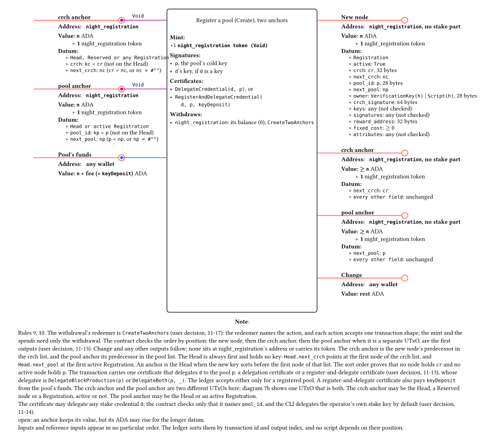

### 7b. Register a pool (Create), one anchor

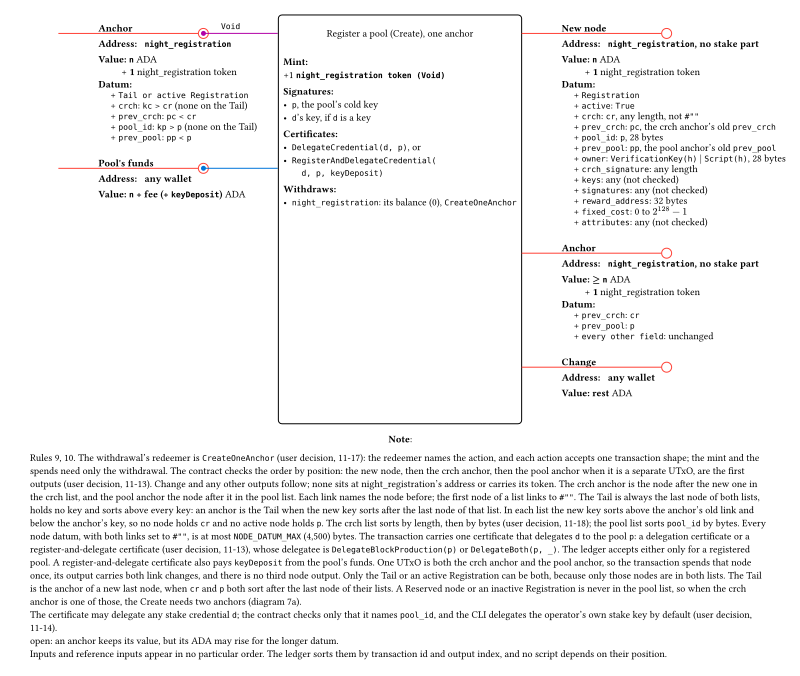

The crch anchor is the node after the new one in the crch list; the pool anchor is the node after it in the pool list. The two anchors are either two UTxOs (7a, redeemer `CreateTwoAnchors`) or one UTxO in both lists (7b, redeemer `CreateOneAnchor`), so a Create spends one or two anchor nodes. In 7a the crch anchor may be the Tail, a Reserved node or a Registration, active or not, and the pool anchor may be the Tail or an active Registration. In 7b the one anchor is the Tail or an active Registration. A Reserved node or an inactive Registration is never in the pool list, so when the crch anchor is one of those, the Create needs two anchors (7a). In each list the new key sorts above the anchor's old link and below the anchor's key (the Tail has no key), and the new node takes the anchors' old links. The transaction's first outputs are, in this order (user decision, 11-13); change and any other outputs follow:

1. the new node;
2. the crch anchor, with `prev_crch` set to the new node's `crch`;
3. the pool anchor, with `prev_pool` set to the new node's `pool_id`. In 7b there is no third output: output 2 carries both changes.

- Rule 9: both lists stay sorted. The new node's fields meet rule 9 (above), and the anchors, whose links grow, still meet `NODE_DATUM_MAX`, which leaves the links out. The contract checks nothing inside `keys`, `signatures` or `attributes`; Midnight validates them (user decision, 11-14).
- Rule 10: the transaction inserts one Registration node into both lists, with `active` True. The cold key (`pool_id`) signs, and the transaction delegates a stake credential to `pool_id` with either a delegation certificate (`DelegateCredential`) or a register-and-delegate certificate (`RegisterAndDelegateCredential`), whose delegatee names the pool (user decision, 11-13). The certificate may delegate any stake credential; the contract checks only that it names `pool_id`, and the CLI delegates the operator's own stake key by default (user decision, 11-14). No node changes except the new node and the anchors' links.

### 8. Update a registration

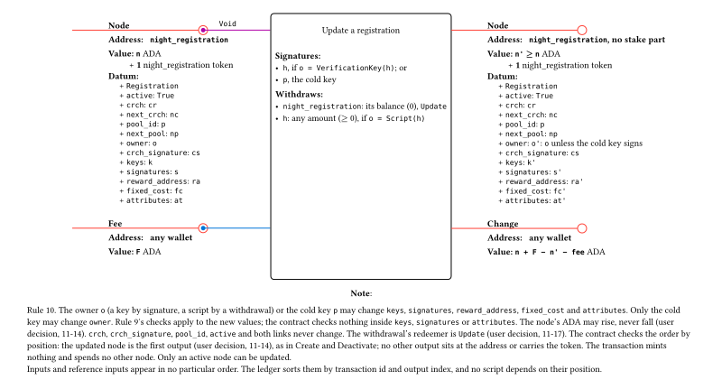

- Rule 9: the changed fields meet rule 9; the contract checks nothing inside `keys`, `signatures` or `attributes`.
- Rule 10: the owner or the cold key may change `keys`, `signatures`, `reward_address`, `fixed_cost` and `attributes`. Only the cold key may change `owner`. `crch`, `crch_signature` and `pool_id` never change. The transaction changes one node, whose ADA may rise, never fall (user decision, 11-14).
- The updated node is the transaction's first output (user decision, 11-14), as in Create and Deactivate. Change and any other outputs follow.

### 9. Deactivate a registration

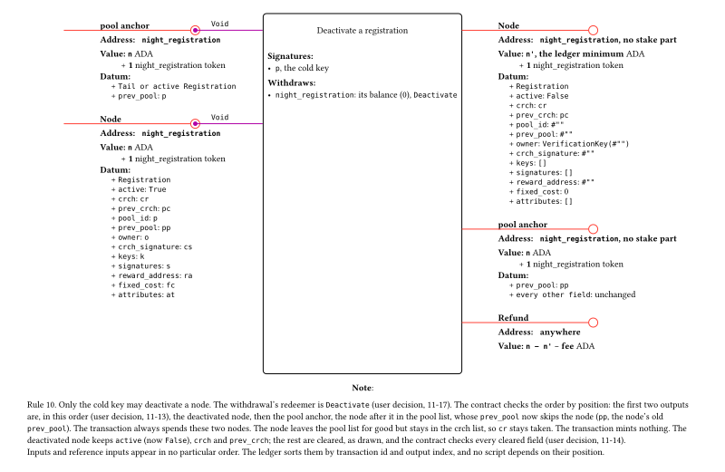

- Rule 9: the pool list stays sorted after the node leaves it.
- Rule 10: only the cold key may deactivate. The node leaves the pool list for good and keeps `active` (now False), `crch` and `prev_crch`. The rest are cleared (user decision, 11-14): `pool_id`, `prev_pool`, `crch_signature` and `reward_address` become `#""`, `owner` becomes `VerificationKey(#"")`, `keys`, `signatures` and `attributes` become empty, and `fixed_cost` becomes 0. The contract checks every cleared field.
- A Deactivate always spends two nodes: the node and the node after it in the pool list (the pool anchor), whose `prev_pool` is the node's `pool_id`. The node stays in the crch list, so no crch link changes, and the anchor can never be the node itself.
- The transaction's first two outputs are, in this order (user decision, 11-13): the deactivated node, then the pool anchor, whose `prev_pool` is now the node's old `prev_pool`. Change and any other outputs follow.

## Reserve logic v2

PR 406 section names used below: Cardano Reserve release transition (rules 1–8), Pause, upgrade, and freeze, Freeze, and Backwards Compatibility Assessment.

Order on a network:

1. Register reserve_logic_v2's credential and mint the two init tokens (10). The deployer keeps the tokens until Init burns them; the contract checks nothing about where they go.
2. Stage reserve_logic_v2 (16). For tests on the staging track, mint the staging params (11) and run Init on the staging track (12b), which burns the `"staging"` token.
3. Before the promote, gather the reserve's NIGHT into one UTxO at reserve_forever with the current reserve_logic's Merge (`lib/logic/script.ak`; Merge never spends the forever NFT's state UTxO). Init reads that UTxO and checks that it holds exactly `release_initial_reserve_star` NIGHT.
4. Promote reserve_logic_v2 (17), then run Init on the main track (12a), which burns the `"main"` token.
5. Release (13). Pause and unpause (14, 15) work after Init until the freeze (19), which stops them.
6. Freeze (18, then 19) within 90 days of `release_anchor_posix_ms`.

Every spend of the reserve forever NFT or of the reserve's NIGHT runs `reserve_forever`. `reserve_forever` needs a withdrawal from the `logic` on the two-stage main UTxO (`reserve_logic_v2`) and from `mitigation_logic` when that field is set. reserve_logic_v2 has exactly three purposes: mint (the init tokens of diagram 10 and the Init burn of diagram 12), withdraw (Init, Release, Pause, Unpause), and publish (registration only). It has no spend purpose, and no UTxO sits at its address (user decision, 11-14). Diagram 10 runs reserve_logic_v2 alone; diagram 11 runs reserve_staging_params alone.

### 10. Register reserve_logic_v2's credential and mint the init tokens

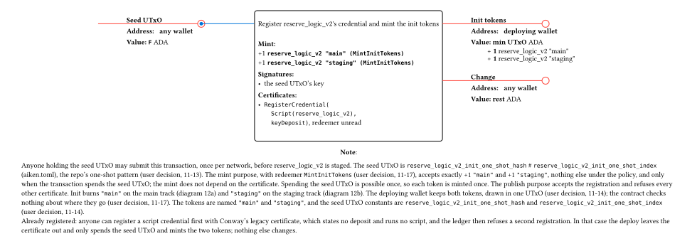

- User decision, 11-13: the deploy registers the credential and mints two init tokens under reserve_logic_v2's policy, `"main"` and `"staging"`, one each.
- Mint purpose, redeemer `MintInitTokens` (user decision, 11-17): the mint is exactly +1 `"main"` and +1 `"staging"`, nothing else under the policy, and only in a transaction that spends the seed UTxO (`reserve_logic_v2_init_one_shot_hash`, `reserve_logic_v2_init_one_shot_index`). The mint does not depend on the certificate. The seed UTxO can be spent once, so each token is minted once.
- Publish purpose: accepts the registration and refuses every other certificate.
- When the credential is already registered (anyone can register a script credential first with Conway's legacy certificate, which runs no script), the deploy leaves the certificate out and only spends the seed UTxO and mints the tokens.
- The deploying wallet keeps both tokens, drawn in one UTxO (user decision, 11-14). The contract checks nothing about where they go (user decision, 11-17).
- The tokens are named `"main"` and `"staging"`, and the seed UTxO constants are `reserve_logic_v2_init_one_shot_hash` and `reserve_logic_v2_init_one_shot_index` (user decision, 11-14).

### 11. Mint the staging-track params

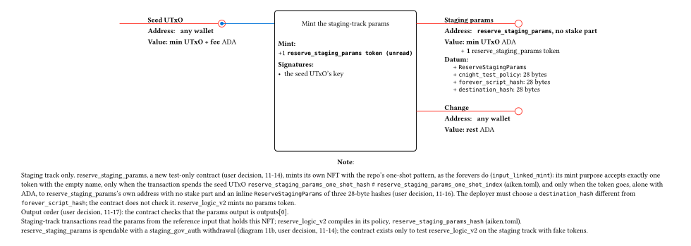

- reserve_staging_params, a new test-only contract (user decision, 11-14), mints its own NFT with the forevers' one-shot pattern (`input_linked_mint`): one token with the empty name, only when the transaction spends the seed UTxO (`reserve_staging_params_one_shot_hash`, `reserve_staging_params_one_shot_index`), sent alone with ADA to its own address with no stake part and an inline `ReserveStagingParams` of three 28-byte hashes (user decision, 11-16).
- The deployer must choose a `destination_hash` different from `forever_script_hash`; the contract does not check it.
- reserve_logic_v2 mints no params token. On the staging track it reads the params from the reference input holding this NFT; it compiles in the NFT's policy, `reserve_staging_params_hash`.
- reserve_staging_params is spendable with a staging_gov_auth withdrawal (diagram 11b, user decision, 11-14).
- Output order (user decision, 11-17): the contract checks that the params output is outputs[0].

### 11b. Spend the staging params

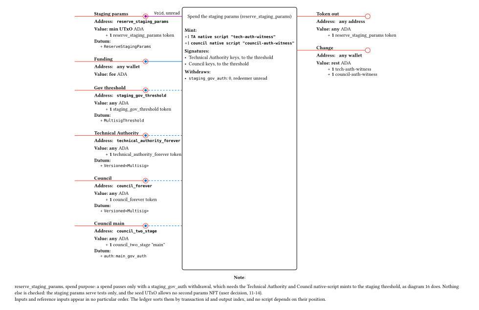

- reserve_staging_params, spend purpose: passes only with a staging_gov_auth withdrawal; nothing else is checked.

### 12a. Init on the main track

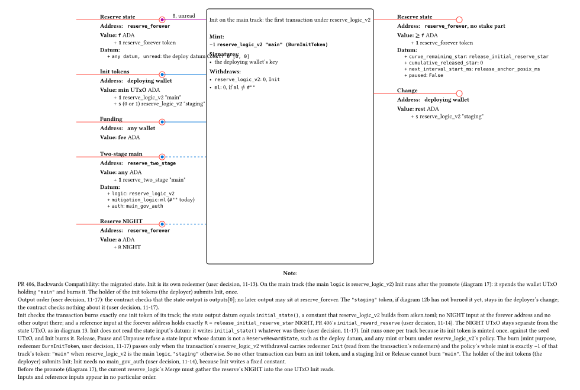

### 12b. Init on the staging track

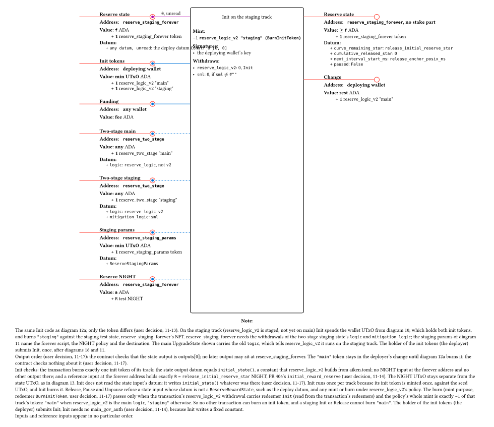

- Backwards Compatibility: the migrated state puts the whole reward reserve on the curve, records nothing released, and starts the first interval at `anchor_posix_ms`.
- User decision, 11-13: the withdrawal redeemer is `Init`. The same Init code runs on both tracks and burns that track's init token: `"main"` on the main track, `"staging"` on the staging track (against reserve_staging_forever's NFT).
- Init: the transaction burns exactly one init token of its track; the state output datum equals `initial_state()`, a constant built from aiken.toml; no NIGHT input and no other output at the forever address. Init does not read the state input's datum; it writes `initial_state()` whatever was there (user decision, 11-17).
- Init reads the reserve's NIGHT UTxO as a reference input, not spent, and checks that it sits at the forever address and holds exactly `release_initial_reserve_star` NIGHT, PR 406's `initial_reward_reserve` (user decision, 11-14).
- Release, Pause and Unpause refuse a state input whose datum is not a `ReserveRewardState`, such as the deploy datum, and any mint or burn under reserve_logic_v2's policy. Init runs once per track because its init token is minted once, against the seed UTxO, and Init burns it.
- The burn (mint purpose, redeemer `BurnInitToken`, user decision, 11-17) passes only when the transaction's reserve_logic_v2 withdrawal carries redeemer `Init` and the policy's whole mint is exactly −1 of that track's token (`"main"` on the main track, `"staging"` on the staging track). No other transaction can burn an init token, so a staging-track transaction cannot burn `"main"`.
- Output order (user decision, 11-17): the contract checks that the state output is outputs[0]; no later output may sit at the forever address.
- Init spends the wallet UTxO from diagram 10 and burns its track's token. The other token stays in the deployer's change until its own Init burns it; the contract checks nothing about it (user decision, 11-17).
- The holder of the init tokens (the deployer) submits Init; Init needs no main_gov_auth (user decision, 11-14).

### 13. Release one interval to the ICS

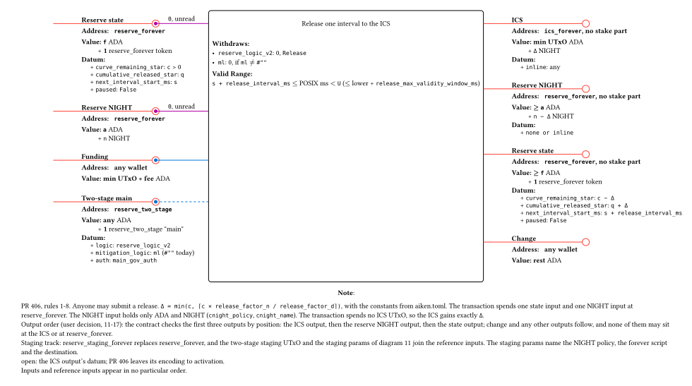

- Rules 1 and 2: releases are not paused, and `curve_remaining_star` is above zero.
- Rule 3: the validity interval is no wider than `release_max_validity_window_ms`, and its lower bound is at least `next_interval_start_ms + release_interval_ms`.
- Rule 4: `Δ = min(c, ⌈c × release_factor_n / release_factor_d⌉)`.
- Rule 5: the reserve loses exactly `Δ` NIGHT, and the ICS gains exactly `Δ`.
- Rule 6: the state moves by `Δ` and one interval; nothing else changes.
- Rule 7: the reserve inputs, the NFT and NIGHT match the compiled hashes.
- Rule 8: the reserve's ADA does not fall, and no reserve value reaches the submitter.
- The transaction spends one NIGHT input (user review).
- Output order (user decision, 11-17): the contract checks the first three outputs by position: the ICS output, then the reserve NIGHT output back at reserve_forever, then the state output. Change and any other outputs follow; none of them may sit at the ICS or at reserve_forever.

### 14. Pause releases

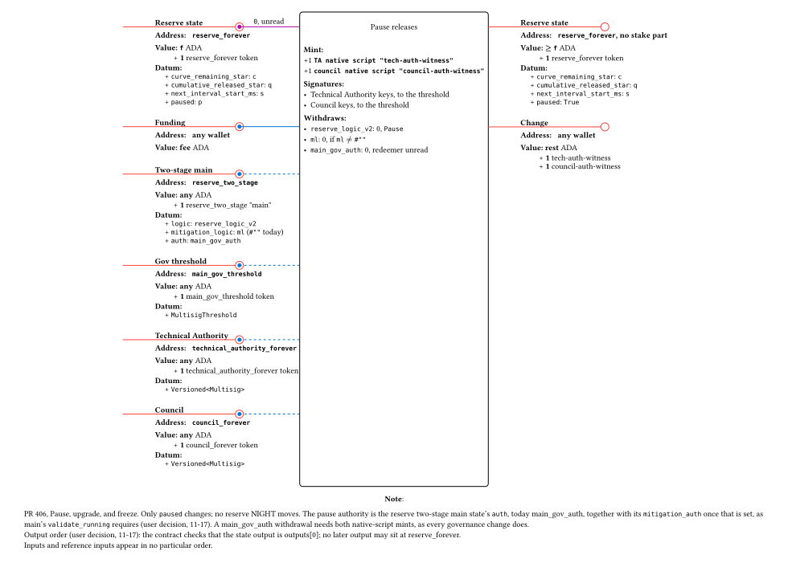

- Pause, upgrade, and freeze: a pause stops releases and changes nothing else.
- The pause authority is the `auth` of the reserve two-stage main state (main_gov_auth), which needs the Technical Authority and Council multisigs, together with its `mitigation_auth` once that is set, as main's `validate_running` requires (user decision, 11-17).
- Output order (user decision, 11-17): the contract checks that the state output is outputs[0]; no later output may sit at the forever address.

### 15. Unpause releases


- As diagram 14, with `paused` False.

### 16. Stage reserve_logic_v2

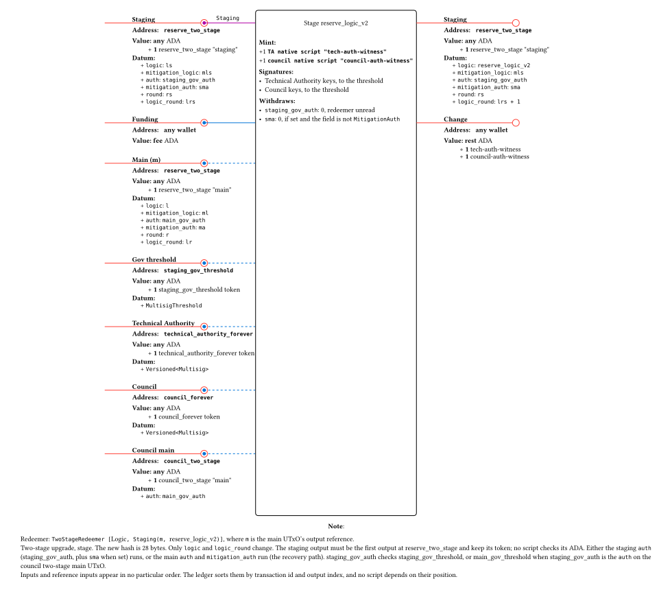

- `two_stage_upgradable`, `Staging` branch: the transaction spends the staging UTxO and reads the main UTxO by the output reference in the redeemer. Only `logic` and `logic_round` change, and the staging token stays.
- `update_staging_field`: the new hash is 28 bytes. Either staging_gov_auth (with the staging `mitigation_auth` when set) runs, or the main `auth` and `mitigation_auth` run.
- `staging_auth_multisig_validation`: the Technical Authority and Council native-script mints meet the staging threshold.
- `two_stage_upgradable` takes the first output at reserve_two_stage as the new staging UTxO, so the builder must put that output first among the outputs at that address.

### 17. Promote reserve_logic_v2 to main

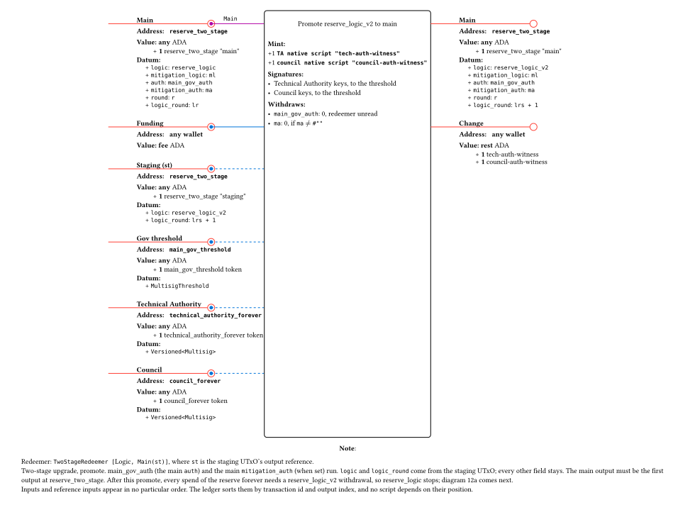

- `two_stage_upgradable`, `Main` branch: the transaction spends the main UTxO and reads the staging UTxO by the output reference in the redeemer.
- `promote_staging_field_to_main`: main_gov_auth and the main `mitigation_auth` (when set) run. `logic` and `logic_round` come from the staging UTxO.
- `auth_multisig_validation`: the Technical Authority and Council native-script mints meet the main threshold.
- As in diagram 16, the new main UTxO must be the first output at reserve_two_stage.

### 18. Stage the freeze

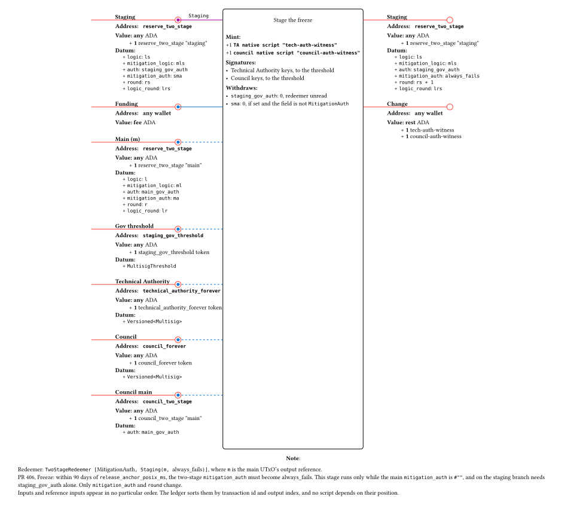

- PR 406, Freeze: within 90 days of `anchor_posix_ms`, `mitigation_auth` becomes always_fails.
- `update_staging_field`, `MitigationAuth`: allowed only while the main `mitigation_auth` is empty. Only `mitigation_auth` and `round` change.

### 19. Promote the freeze

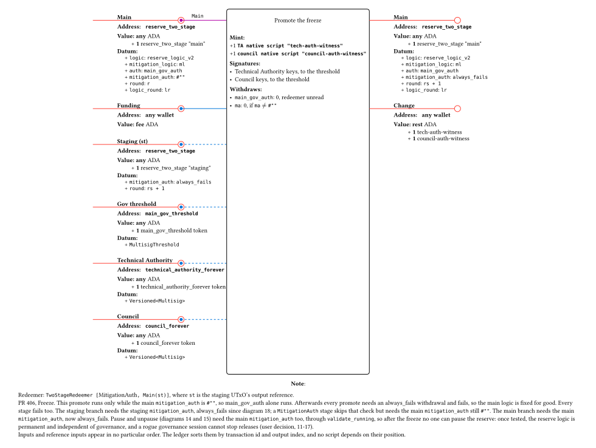

- `promote_staging_field_to_main`, `MitigationAuth`: allowed only while the main `mitigation_auth` is empty.
- After the freeze, every promote needs an always_fails withdrawal and fails, so the main logic is fixed for good.
- Every stage fails too. `update_staging_field` (lines 280–290) needs either the staging `mitigation_auth`, always_fails since diagram 18, or the main `mitigation_auth`, now always_fails. A `MitigationAuth` stage skips the staging check but needs the main `mitigation_auth` still empty.
- Pause and unpause stop too: they need the main `mitigation_auth`, now always_fails, through `validate_running`. Once tested, the reserve logic is permanent and independent of governance, so a rogue governance session cannot pause the reserve (user decision, 11-17).

## Not drawn

- PR 406's funding pool with `max_fee` (Transaction fees and release liveness): deferred to its own script.
