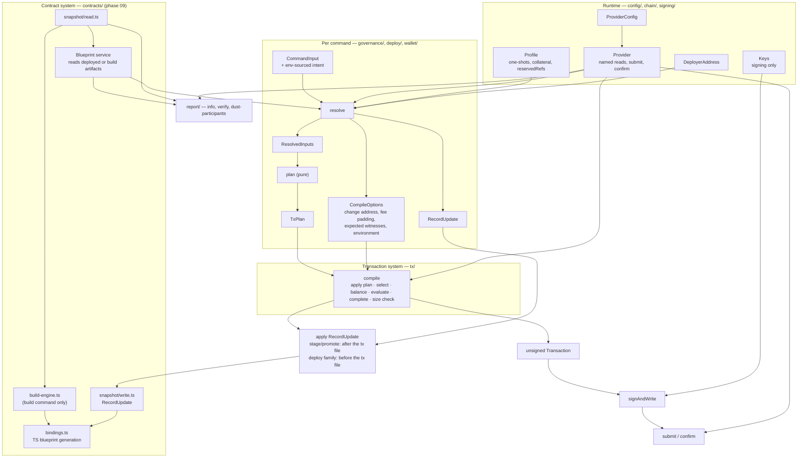

# CLI architecture plan — index

Goal: every transaction command has the same visible shape, Blaze lives in
one module, and each concern of `cli/` has one owner:

```
command input ─► resolve ─► ResolvedInputs ─► plan ─► TxPlan ─► compile ─► unsigned Transaction
                                                                               │
                                       record (snapshot update) ◄──────────────┤
                                                                               ▼
                                                              signAndWrite ─► submit / confirm
```

Blaze stays. Coin selection, balancing and script evaluation stay Blaze's,
as private stages of `compile` (`TxBuilder` → `complete()`). This plan does
not write a balancer and does not replace any Blaze adapter. Aiken is not
touched.

Starting point (2026-10-11, `cli/04-effect`): 66 `cli/` files, 13.4k lines.
Every transaction command exposes `build*Tx(blaze, inputs, params) =>
TxBuilder`; its program hand-passes `knownUtxos` and `witnesses` to
`buildTx` (`cli/chain/complete-tx.ts`), repeating what the builder added.
`deploy.ts` completes through `completeBuilder` (no local UPLC, no labels);
`staging-track.ts` through `buildTx`. `chain/transaction.ts` (353 lines)
mixes datum decoding, script helpers, signing and UTxO refs;
`chain/governance-provider.ts` (360 lines) is governance lookups behind a
chain name; `governance/two-stage-upgrade.ts` is 827 lines. `Settings`
hands provider credentials, private keys, the profile, the deployer
address and env-sourced intent values to anything that asks.

## Target architecture

Three systems. Arrows are allowed dependencies.



- `Blueprint` is the contract resolver. It reads artifacts; it never runs a
  build. `--use-build` (`withServicesUseBuild`) picks the build output
  instead of the snapshot. `build-engine.ts` is reached only from
  `commands.ts` and `contracts/build.ts`.
- The deployed-scripts snapshot is a manifest the CLI writes when it builds
  transactions, not chain truth. Chain truth is `Provider`.
  A `RecordUpdate` is a workflow output, prepared during the command's
  resolve and never written before the command's existing apply point.
  Deploy and staging-track prepare theirs before any chain call
  (`prepareDeploySnapshot`); stage and promote prepare theirs after the
  chain reads that name the validator (promote reads the staging UTxO's
  logic hash, then `validatorNameByHash`). Apply points are kept, not
  unified: stage and promote after `signAndWrite`; `deploy` and
  `deploy-staging-track` after every transaction is built and before
  `reportDeployment` writes the transaction file.
- `compile` reads no `Settings`, `Blueprint`, `Wallet` or keys. Everything
  it needs arrives in `TxPlan` and `CompileOptions`; it calls `Provider` for
  protocol parameters and evaluation only.
- `Keys` reaches `signing/` and nothing else. `compile` gets an expected
  witness count, never a `Signer`.

## Dependency rules (enforced in phase 08)

| Module | May import | Must not import |
|---|---|---|
| `tx/**` | Blaze, `chain/provider`, `output`, `errors`, `datum/**` | `contracts/**`, `config/**`, `signing/**`, `chain/**` other than `chain/provider` |
| a command's `plan*` | `tx/plan`, `tx/scripts`, `datum/**` | `effect` services, `chain/**`, `config/**`, `contracts/**` (enforced for `deploy/builders`, whose module holds only plans) |
| `signing/**` | `config/keys` | `contracts/**` |
| `config/keys` | — | imported only by `signing/**` and `run.ts` (the layers) |
| `config/provider-config` | — | imported only by `chain/provider`, `chain/blockfrost`, `chain/registration`, `run.ts` |
| `contracts/snapshot/write` | — | imported only by `deploy/**`, `governance/two-stage-upgrade/logic-record` |
| `contracts/snapshot/read` | — | imported only by `contracts/**`, `deploy/**`, `governance/two-stage-upgrade/**`, `report/verify` |
| `contracts/bindings` | — | imported only by `contracts/build`, `contracts/snapshot/write` |
| `contracts/snapshot/storage` | — | imported only by `contracts/snapshot/read`, `contracts/snapshot/write` |
| `contracts/snapshot/names`, `contracts/snapshot/context` | — | anything under `contracts/snapshot/` (they are the leaves) |
| `contracts/snapshot/**`, `contracts/bindings` | — | `output` (the contract system returns outcomes; commands print) |
| `contracts/build-engine` | `contracts/snapshot/read` | imported only by `contracts/build`, `commands` |

## Phases

| Phase | File | Delivers | Depends on |
|---|---|---|---|
| 01 | [01-module-moves.md](01-module-moves.md) | `chain/transaction.ts` and `chain/governance-provider.ts` split by owner; `signing/` and `tx/` created by moves; no behaviour change | — |
| 09 | [09-contract-system.md](09-contract-system.md) | `versions.ts` split into `snapshot/read` and `snapshot/write`; `bindings.ts`; `RecordUpdate` / `applyRecordUpdate` as the one snapshot write path | 01 |
| 02 | [02-settings-split.md](02-settings-split.md) | `Settings` replaced by `ProviderConfig`, `Keys`, `Profile`, `DeployerAddress`; env-sourced intent read by the commands that use it | 01 |
| 03 | [03-provider.md](03-provider.md) | `Provider.use(op, f)` replaced by named methods; Blaze built only by `Provider.blazeFor(wallet)`, reached only from `tx/` | 01 |
| 04 | [04-tx-plan-compile.md](04-tx-plan-compile.md) | `TxPlan`, `CompileOptions`, `compile`, `toTxBuilder`; derived `knownUtxos`, witness requirements, labels; pilot `merge-utxos` | 02, 03 |
| 05 | [05-governance-commands.md](05-governance-commands.md) | governed-forever family, `change-multisig`, `migrate-federated-ops`, `run-cnight-mint`, `register-stake`, `mint-staging-state` on plan/compile | 04 |
| 06 | [06-two-stage-upgrade.md](06-two-stage-upgrade.md) | `two-stage-upgrade/` folder by phase; stage/promote on plan/compile; their snapshot writes through `RecordUpdate` | 05, 09 |
| 07 | [07-deploy-wallet.md](07-deploy-wallet.md) | deploy builders, `deploy`, `deploy-staging-track`, `simple-tx`, `mint-tcnight` on plan/compile; one completion path | 04, 09 |
| 08 | [08-enforce-cleanup.md](08-enforce-cleanup.md) | `build*Tx`, `buildTx`, `complete-tx.ts` gone; dependency rules in the lint gate; docs | 05, 06, 07 |
| 10 | [10-commands.md](10-commands.md) | `cli/commands/` (23 one-command files) merged into one `cli/commands.ts` | 08 |

Order: 01 → 09 → 02/03 → 04 → 05/07 → 06 → 08 → 10. 09 is numbered last to
keep the other files' numbers (plans/effect ran 08 and 09 before 05 the
same way). 02 and 03 can run in either order; so can 05 and 07.

## Guardrails for every phase

- `just fmt && just build && just check && bun test` green; one `jj`
  commit per step; no push. No `sign-and-submit` / `combine-signatures`
  against a network.
- Clean cutover per step: a move deletes the old module in the same commit;
  no re-exports, no aliases. A new folder never sits beside the module it
  replaces.
- File size: below about 600–700 lines, size alone is no reason to split a
  module. Past that, split it by what it holds. A flat list of
  declarations reads like a table and may run longer.
- Behaviour-preserving: same output, same files, same transaction. A
  ported command's transaction id on the emulator equals the id its old
  builder produced from the same UTxOs (metadata is a fixed CIP-20 text,
  so ids are comparable). The comparison is a throwaway script run once per
  port, deleted before the commit. The one planned exception is phase 07
  task 0 (deploy runs the local check); deploy's later port compares
  against the build after task 0.
- Tests call functions, never the CLI binary and never a command program.
  Submitting to a network is manual QA, never a test. Signing tests check
  that the witnesses written into a transaction verify against its id
  (`signAndWrite`, `combine-signatures` tests already do); there is no
  sign → submit → confirm test helper. Emulator tests keep
  `emulator.expectValidTransaction(blaze, builder)`, the in-process
  ledger check of the CLI function and the validator together:
  `builder` becomes `toTxBuilder(blaze, planX(inputs, params), options)`.
  Pure plan tests only for consumer-visible invariants (the merged output
  holds both inputs' ADA and cNIGHT), never field-by-field restatements of
  the plan.
- This plan replaces the plans/effect index guardrail "every command that
  builds a transaction exposes its builder … as `(resolved inputs, params)
  => TxBuilder`". Phase 04 edits that line to point here.
- A deviation is recorded in the commit that makes it and in the phase file
  it deviates from.

## Decisions taken (change here if overruled)

- Every command runs the local UPLC check when the plan has known UTxOs;
  `CompileOptions` has no flag for it. `deploy` skips it today only
  because the Effect port kept the pre-Effect stdout
  (plans/effect/05, step 1); no technical reason is recorded. Phase 07
  task 0 switches deploy to it as its own behaviour change, before the
  port, so the port's same-id check runs against the new baseline.
- The snapshot is still written when transactions are built, not on
  confirmation. Moving it to confirmation is a separate decision.
- The Blaze patches (`patches/@blaze-cardano%2F*.patch`) are not touched;
  upstreaming them is outside this plan.
- No caching (user, 2026-10-12): a run makes a handful of reads, so
  protocol parameters, the profile, the blueprint and Blaze are read or
  built on each use. The provider connection is shared for the run, which
  is connection reuse rather than a cache.
